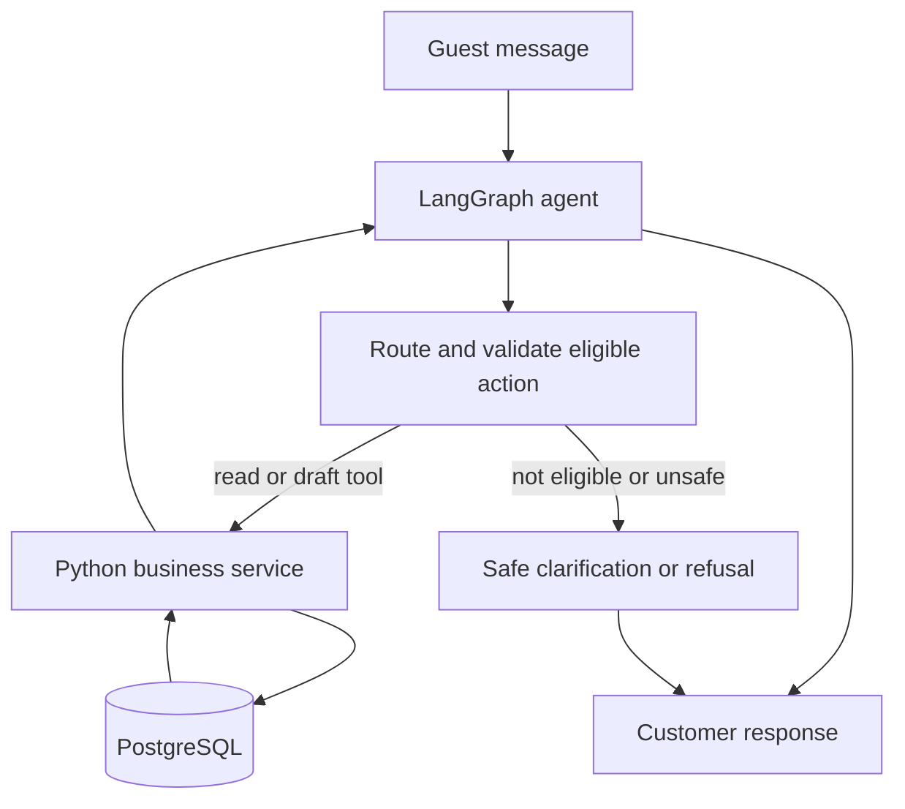
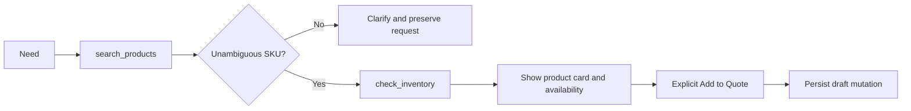
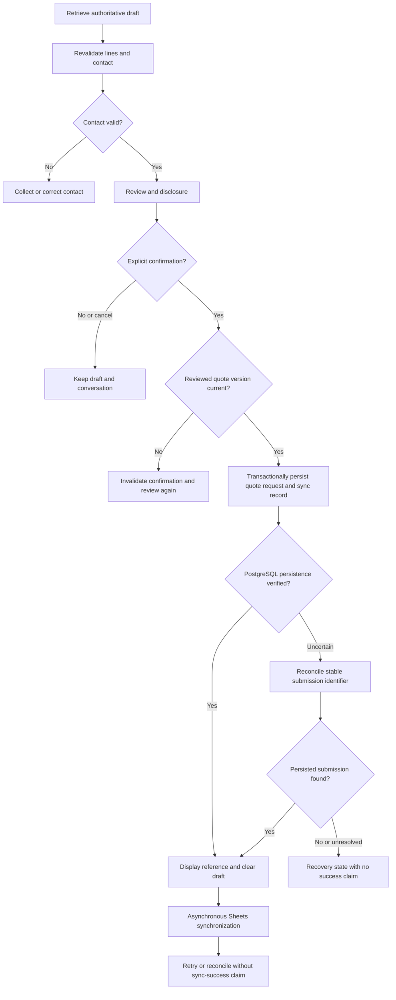
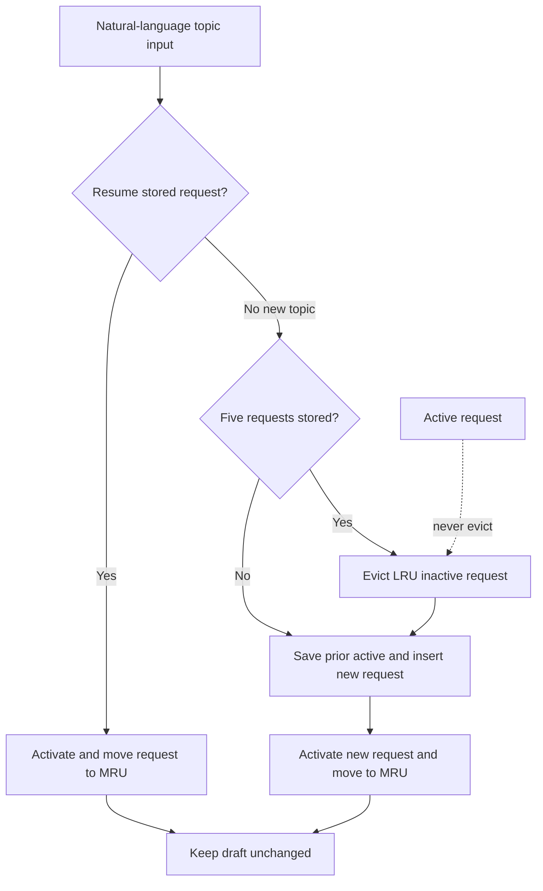
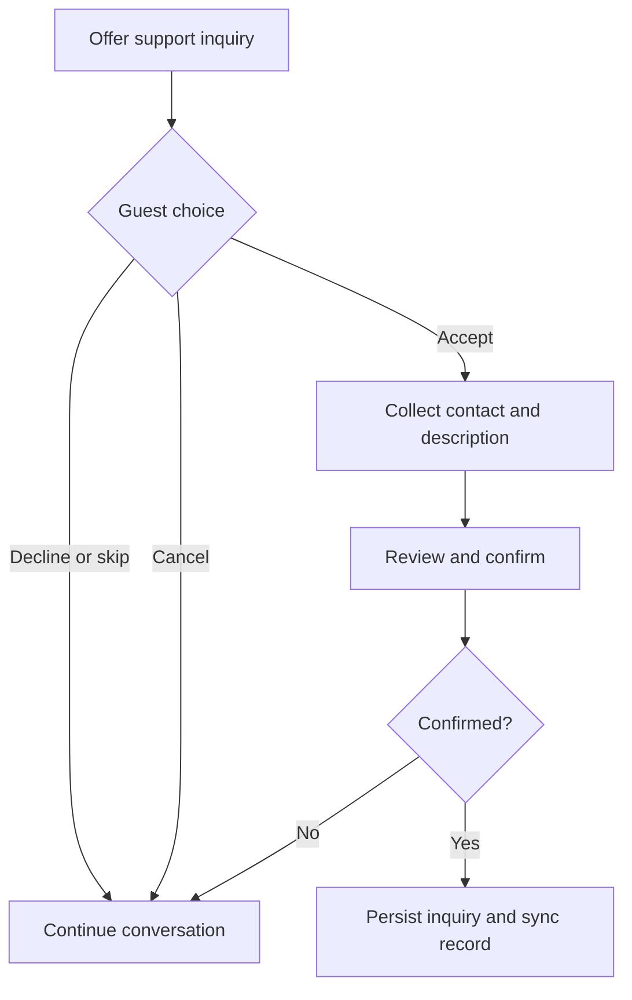

# Conversation Flow Specification — Medical Supply AI Assistant

| Field | Value |
| --- | --- |
| Organization | Queens Tech Bros (QTB) |
| Version | 1.1 |
| Status | Approved |
| Owner | QTB Product and Engineering |
| Date | 2026-11-04 |
| References | [PRD v1.2](01-product-requirements.md); [Product Catalog & Inventory Baseline v1.0](03-product-catalog-inventory.md); [Business Operations & Knowledge Base Specification v1.0](04-business-operations.md); [System & AI Architecture v1.0](05-system-ai-architecture.md) |

## 1. Purpose and scope

This specification defines the approved conversational behavior for a guest-facing, portfolio-first medical-supply assistant. It uses synthetic catalog, pricing, inventory, company-policy, and operational data. It does not process payments, place orders, reserve inventory, provide clinical recommendations, or submit customer requests to actual business operations.

The document is a behavioral and test-design baseline, not an implementation or API specification. Exact types, database schema, and API contracts are deferred to Document 07.

## 2. Approved conversation architecture

The assistant uses one LangGraph tool-calling agent, not multiple specialized agents. The LLM interprets a customer utterance and may select from approximately 12 narrowly scoped tools. LangChain supplies tool definitions, model integration, structured-output support, and retrieval integration. LangGraph manages graph execution, checkpoints, request context, and workflow transitions. Python/FastAPI business services enforce deterministic validation and persistence. PostgreSQL is authoritative for catalog, numeric inventory, drafts, submitted inquiries, and durable synchronization records. Google Sheets synchronization is asynchronous and is not a discretionary LLM tool. As specified in Document 05, conversational model access uses OpenRouter, RAG embeddings use the Gemini Embedding API, FastAPI returns complete validated JSON responses, and one lightweight PostgreSQL-backed worker processes quotation and support synchronization jobs without Celery or Redis.

| Concern | LLM-selected action | Deterministic application-enforced action |
| --- | --- | --- |
| Discovery and information | Select an eligible read-only tool and formulate a grounded response. | Validate inputs, apply filters, limit results, and return approved data. |
| Draft operations | Identify an explicit customer intent and proposed SKU/quantity. | Resolve SKU, validate draft/session ownership, apply idempotency, and persist or reject the mutation. |
| Submission | Recognize review-ready intent or an explicit confirmation. | Require valid contact, current quote version, disclosure, confirmation, transactionally persist submission and sync record, then return confirmation. |
| Synchronization | No selection authority. | Worker/service processes durable records and reconciles uncertain writes. |

Tool exposure and graph routing must restrict privileged operations: protected submission tools are available only from their review-and-confirmation states, and all services validate session scope, request association, inputs, and authorization. Prompt instructions alone are not authorization controls.

## 3. Conversation state

The approved conceptual state is:

```python
class ConversationState(TypedDict):
    messages: list
    active_request_id: str | None
    requests: dict[str, dict]
    request_order: list[str]
    pending_action: dict | None
    session_id: str
    draft_quote_id: str | None
```

| Field | Meaning |
| --- | --- |
| `messages` | Bounded recent conversational messages and system/tool events used for the current turn; it is not a permanent copy of every request history. |
| `active_request_id` | Identifier of the request context currently receiving customer intent. It may be `None` before a topic exists. |
| `requests` | Up to five request contexts keyed by ID. A context may hold filters, selected SKU, requested quantity, relevant compact summary, displayable topic label, and an unanswered clarification. It is not a quote draft or source of authoritative catalog facts. |
| `request_order` | Least-recently-used order, from least recently used at index 0 to most recently used at the final index. Every creation, activation, resumption, or meaningful context update moves that request to the final index. |
| `pending_action` | A proposed action awaiting clarification, review, consent, or confirmation. It always includes its originating `request_id`, action type, required missing fields, and expiry/cancellation status. |
| `session_id` | Opaque guest-session identifier used to scope checkpoints and business records. |
| `draft_quote_id` | Reference to the one independently persisted active draft for the session. The authoritative draft lives in PostgreSQL. |

Creating a new topic creates and activates a request context. Switching saves the former active context, then activates the matching context through a natural-language reference. The frontend presents one continuous conversation and exposes no saved-topic chips, topic tabs, chat threads, or topic-navigation sidebar. A natural-language resumption moves the matching stored context to the most-recent end of `request_order`. At five contexts, creation of a new topic evicts the least-recently-used **inactive** context; the active context is never selected for eviction. Eviction removes only conversational context, never the PostgreSQL draft or an immutable submission.

An unresolved clarification belongs to its originating request. On a topic switch, it remains with that request and is not eligible to consume a reply intended for the newly active topic. On resumption, the graph may present that request's unresolved clarification again. If a reply could apply to more than one request, the graph asks the guest to select a topic rather than guessing. Cancellation clears only the relevant pending operation and preserves unrelated request state and the draft.

Protected quote and support confirmations are pending actions bound to the reviewed content or quote version, originating request, session, and valid confirmation state. A topic switch invalidates neither a valid draft nor an unrelated request, but it cannot allow a stale or ambiguous “yes” to trigger a submission: the protected workflow must be active, the originating request/session must match, and reviewed content/version must still be current. Request contexts remain distinct from quote drafts, and switching topics never changes the draft without an explicit draft command.

Catalog data, numeric inventory, and policy content are not copied into long-lived request context as authoritative facts. Compact summaries retain only useful conversational references. Before a fresh stock claim, review, or submission, services re-read and validate current PostgreSQL facts. To manage model context, the graph supplies the active request's compact summary, recent relevant messages, applicable pending action, and only selected saved-topic metadata; it does not blindly send all stored history.

The seven-day rolling inactivity window governs checkpoint restoration. A valid same-browser refresh restores protected state; expiration invalidates protected conversational restoration and any old pending confirmation cannot be reused. A prior draft ID alone is not authorization to access a prior guest's business records; session scope and server-side validation remain required. Previously submitted inquiries follow their separately approved retention policy and are not automatically deleted solely because a session expires. Exact Python types and database schema are deferred to Document 07.

## 4. Tool catalog and permissions

All contracts below are conceptual. Tool inputs are validated server-side, session-scoped where relevant, and logged with a correlation identifier. Read-only failures return a safe unavailable/error result. Mutating tools return verified persisted state or an explicit uncertainty result; they never claim success from an unverified tool call.

| Tool | Purpose, conceptual inputs, and output | Preconditions and validation | Mode, failure, and idempotency |
| --- | --- | --- | --- |
| `search_products` | Find products by text, attributes, filters, pagination cursor; returns up to five cards and a show-more cursor. | Valid search/filter values; result limits; no draft mutation. | Read-only. Safe transient retry once; failures show no results are not implied. No idempotency key required. |
| `get_product_details` | Retrieve one SKU's approved details; input SKU; returns attributes, image/fallback, indicative price, and categorical availability. | SKU must resolve; public fields only. | Read-only. Missing SKU is explicit; re-read on fresh claims. |
| `check_inventory` | Validate SKU and requested quantity; returns categorical availability and validation status, never public numeric stock. | Positive quantity and current catalog SKU. | Read-only. Safe transient retry once; distinguish unavailable data from verified insufficient inventory. |
| `find_alternatives` | Find up to three comparable available items; inputs original SKU/attributes and quantity; returns differences and eligibility. | Quantity check and product-safety rules; no unsupported clinical/OTC substitution. | Read-only. Empty alternatives is explicit; no idempotency key. |
| `get_company_info` | Retrieve approved structured facts; input requested fact type; returns fact and source identity. | Fact must be approved and current. | Read-only. Missing/conflicting facts are disclosed, not invented. |
| `search_knowledge_base` | Retrieve approved policy/document passages; input question and optional scope; returns grounded passages and source names. | Retrieval scope, prompt-injection isolation, source limits. | Read-only. Knowledge gap returns uncertainty and possible support option. |
| `add_quote_item` | Add a resolved SKU and quantity to the active draft; returns authoritative draft/version. | Valid session/draft, unambiguous SKU, positive quantity, explicit customer instruction. | Mutating. Existing line merges under line-identity rules; idempotency-aware; uncertain result is reconciled before retry. |
| `update_quote_item` | Replace or increment one identified draft line; inputs SKU/line, quantity, operation, expected draft version; returns draft/version. | Valid scope, unambiguous target, valid operation/version. | Mutating. Conflict or ambiguity requires clarification; idempotency-aware. |
| `remove_quote_item` | Remove one identified draft line; returns draft/version. | Valid scope, unambiguous line, explicit instruction. | Mutating. Missing/already removed line is explicit; idempotency-aware. |
| `get_draft_quote` | Retrieve authoritative active draft for display/review; returns lines, warnings, and version. | Valid session and draft reference. | Read-only. Draft absence is explicit; no idempotency key. |
| `submit_quote_request` | Protected conversion of reviewed draft into immutable inquiry; inputs confirmed review, contact, expected draft version, stable submission identifier. | Available only through review state; disclosure and explicit confirmation, valid contact, current version, revalidation, session scope. | Protected mutation. Transactionally persists submission and sync record; reconcile duplicate/uncertain submissions by stable identifier. |
| `submit_support_inquiry` | Protected immutable support inquiry; inputs opt-in, contact, description, confirmed review, stable identifier. | Available only after opt-in and review; valid contact/description; explicit confirmation and session scope. | Protected mutation. Transactionally persists inquiry and sync record for Support Inquiries; reconcile duplicate/uncertain submissions. |

Protected tools are workflow operations, not unrestricted general-purpose LLM capabilities. The graph may propose them, but service authorization and state gates decide whether execution is permitted.

## 5. CF-01 — Product Discovery and Clarification

The assistant uses hybrid keyword/attribute and semantic retrieval. It returns relevant results immediately when material constraints are sufficient, with up to five product cards per batch. A Show More action preserves filters and search context. Each card shows image or fallback, attributes, package size, indicative price, categorical availability, and Add to Quote. Search never changes a draft.

| Scenario | Behavior |
| --- | --- |
| Successful | “Show me medium nitrile exam gloves, 2 boxes.” invokes `search_products`; cards are shown. A selected exact SKU can be checked and explicitly added. |
| Ambiguous | “Add gloves” requests a material distinction or presents candidates; no draft line is created until SKU is unambiguous. |
| Zero result | Explain no matching synthetic catalog result, preserve filters, and offer to broaden criteria or request support. Do not fabricate a product. |
| Failure | Explain search is temporarily unavailable, preserve request context, and offer retry; do not imply no inventory exists. |

## 6. CF-02 — Inventory and Alternatives

PostgreSQL holds exact synthetic numeric inventory, while customers see only categorical availability. `check_inventory` validates requested quantity against current inventory. If insufficient, the assistant explains the limitation and may use `find_alternatives` to show at most three items validated for that quantity, with meaningful differences. It avoids unsupported medical or OTC substitutions.

The original SKU and requested quantity may remain in the draft inquiry with an availability warning. Neither a quote nor an alternative promises fulfillment or reserves inventory. Recheck current availability before review/submission and whenever a fresh claim is required. Availability-label thresholds are deferred to Document 03.

## 7. CF-03 — Draft Quote Editing

There is one active PostgreSQL-persisted draft per guest session. An explicit instruction for an unambiguous SKU can mutate it immediately. Adding an existing SKU merges into its existing line; “add 50 more” increments it, while “change to 50” replaces it. Removing deletes the identified line. Under agreed line-identity rules, a SKU appears only once. Topic switching never silently changes the draft.

Example multi-action request: “Add 10 SKU-A, change SKU-B to 50, and remove SKU-C.” The service validates each operation independently. It reports successfully committed and rejected operations separately and does not impose all-or-nothing semantics for the turn. If SKU-B is ambiguous or any persistence outcome is uncertain, it must not claim all three succeeded or blindly replay the uncertain operation; it asks clarification or reconciles the persisted draft/idempotency record. After partial success or uncertainty, it retrieves the authoritative draft before displaying the final draft state. Unavailable products may remain with warnings.

## 8. CF-04 — Quote Review and Submission

The graph retrieves the authoritative draft, revalidates SKU lines and quantities, collects first and last name plus at least one valid email or phone, and requires a fulfillment choice before review. Delivery collects a destination city and only necessary delivery detail; local pickup is a fictional Cali option with no invented street address. The review displays items, quantities, indicative prices, availability warnings, fulfillment choice/details, contact details, and the demo disclosure. Missing or invalid contact or fulfillment details return to collection rather than entering submission. Explicit confirmation may arrive through chat or Submit button, but both route to the same protected backend submission workflow.

The workflow requires quote-version validation. Any draft mutation after review invalidates prior confirmation and requires a new review. Customer refusal or cancellation exits the protected confirmation state without submission and preserves the draft. On a verified confirmation, PostgreSQL transactionally persists an immutable submission and durable sync task with stable identifiers and idempotency protection. Customer confirmation is displayed only after PostgreSQL persistence is verified; then the active draft is cleared and the conversation remains available for a later independent inquiry. Google Sheets sync begins asynchronously only after that confirmed persistence.

For duplicate confirmation, the stable submission identifier resolves the repeat to the existing immutable request. For an uncertain PostgreSQL outcome, the service reconciles by stable identifier before retrying and never displays success without confirmed persistence. A confirmed persistence followed by a Sheets failure remains a successful customer submission with observable, recoverable asynchronous synchronization; it is not represented as successful Sheets synchronization.

## 9. CF-05 — Topic Switching and Request Resumption

One request is active and up to four inactive requests are saved. Guests resume a topic through natural-language messages in one continuous conversation; no saved-topic chip, topic tab, chat thread, or topic-navigation sidebar is displayed. Context includes filters, relevant selections, requested quantity, and pending clarification, but stale catalog and inventory facts are revalidated from PostgreSQL. Pending actions do not leak across requests. The active draft remains independent.

| Transition | Capacity effect | Recency and draft result |
| --- | --- | --- |
| Resume an existing stored request | No eviction. | Activate it and move it to most recent; draft remains unchanged. |
| Create a new request below five stored requests | No eviction. | Save the former active request, insert and activate the new request as most recent; draft remains unchanged. |
| Create a new request at five stored requests | Evict the least-recently-used inactive request before inserting the new request. | Never evict the active request; insert and activate the new request as most recent; draft remains unchanged. |
| Activate or resume any request | No eviction by activation alone. | Move the activated/resumed request to most recent; draft remains unchanged. |

Example sequence: (1) gloves becomes active; (2) “What are your shipping policies?” saves gloves and activates shipping; (3) diagnostic strips saves shipping; (4) sanitizing wipes saves strips; (5) support question saves wipes; (6) OTC label fact creates a sixth topic, evicting the least-recently-used inactive gloves request. “Return to the shipping policies” resumes shipping and moves it to most recent. If the guest then says “that one,” the assistant resolves it only against the resumed topic's explicit candidates; otherwise it asks which topic or SKU is intended.

State restoration occurs only inside the seven-day rolling valid session window.

## 10. CF-06 — Company Information and RAG

`get_company_info` retrieves approved structured facts, such as the business name, status-qualified location, fictional demo hours, and supported inquiry choices. `search_knowledge_base` retrieves approved passages from approximately six planned company documents. The initial retrieval limit is one relevant approved chunk (`RAG_TOP_K=1`); it does not automatically expand to additional chunks. Responses are grounded in those sources, name the source document, and offer expandable supporting excerpts. Retrieved text is untrusted data, not executable instruction.

For “What is your returns policy?” the assistant presents approved policy content and its source. For a missing or conflicting fact, it explains the gap or conflict, avoids invention, and can offer optional support. Medical boundaries still apply: factual OTC label information may be provided, but no diagnosis, treatment, dosage, or clinical substitution.

## 11. CF-07 — Optional Human Support Inquiry

The assistant may offer a human-support inquiry where appropriate, but it never creates one without explicit opt-in. The guest may accept, decline, skip, or cancel. Accepted flow collects first name, last name, email or phone, and a short description; reuse of previously submitted contact details requires explicit confirmation in the same valid session. A final review and explicit confirmation are required.

Submission transactionally saves the immutable inquiry and durable `SUPPORT_SHEETS_SYNC` outbox job in PostgreSQL; the same lightweight Python worker used for quotation jobs asynchronously synchronizes it to the separate Google Sheets Support Inquiries tab. The proposed job name is not a mandatory final enum value. Stable identifiers, retries, duplicate prevention, and reconciliation apply to this job as they do to quotation synchronization. Decline, skip, or cancel creates no inquiry and leaves the conversation and draft unchanged. Submission failure is reported without claiming contact or sync success. The synthetic public demo must not claim that a real employee will contact the visitor.

## 12. CF-08 — Safety, Errors, and Recovery

The assistant may provide verified factual OTC label information only. It rejects or redirects diagnosis, personalized treatment, dosage recommendations, and unsafe pharmaceutical substitutions. Prompt injection and unauthorized operations are constrained by deterministic tool boundaries, server-side input validation, and authorization—not by prompt text alone.

Transient read-only failures may retry once when safe. Uncertain draft mutations require persisted-state/idempotency verification before retry. Uncertain submissions require reconciliation by stable submission identifier/idempotency key before retry, including if a provider failure or the five-tool-execution-round limit interrupts the turn after a protected operation may have reached PostgreSQL. Model, network, rate-limit, or budget failures preserve the authoritative draft and return a recovery state rather than discarding or falsely confirming it. Database outages, invalid input, knowledge gaps, no results, expired sessions, and synchronization failures receive clear recovery states. The assistant never claims persistence, availability, or sync success without verification, and distinguishes unavailable data from verified out-of-stock inventory. Privacy disclosure, input limits, rate limiting, AI cost caps, and protected credentials remain mandatory.

Testable adversarial cases include an instruction embedded in retrieved text, a request to bypass confirmation, repeated Submit actions, cross-topic clarification answers, and a request for a medication dose. Each must be refused, isolated, reconciled, or redirected according to its boundary.

## 13. Cross-cutting workflow rules

- Sessions use a rolling seven-day inactivity expiry; expiration invalidates protected checkpoint restoration and old pending confirmations cannot be reused.
- Cancellation clears only the relevant pending action and preserves unrelated request contexts and the draft. A topic switch never lets an inactive request's clarification or a stale “yes” act on the active request.
- A draft ID is a reference, not authorization: access remains session-scoped and server-validated. Submitted inquiries follow their separate approved retention policy, not automatic deletion solely at session expiry.
- Graph loops are limited to five tool-execution rounds per customer message; repeated failure or the limit exits to a customer-visible recovery state without replaying an uncertain protected operation.
- Tool calls record correlation, request, session, outcome, latency, and error classification without exposing sensitive data to visitors.
- Loading, unavailable-product, empty, error, retry, and confirmed-submission states are clear on mobile layouts and keyboard-accessible controls have visible focus and operable controls/buttons.
- The demonstration/privacy disclosure appears before customer data submission; collection is minimized, real medical or sensitive personal information is discouraged, and data is never forwarded to actual operations.
- LangGraph state is conversational context; PostgreSQL business records are authoritative. No real business operations or actual medical-care service is provided.
- Customer-facing messages never falsely confirm an unverified mutation, submission, or synchronization.

## 14. Flow diagrams and worked examples

### Main agent and tool-execution cycle



### Product discovery to quote edit



### Quote review, durable submission, and asynchronous sync



### Request switching, resumption, and LRU eviction



### Optional support inquiry



Illustrative synthetic trace: Guest: “I need 50 medium nitrile gloves.” Agent: calls `search_products`, then shows synthetic cards. Guest: “Add PPE-NIT-M.” Agent: calls `add_quote_item` and reports the verified draft line. Tool results in this document are illustrative synthetic fixtures, not factual production results.

## 15. Acceptance scenarios and traceability

| Flow | Preconditions | Example input and expected graph/tool action | Expected state and visible result | Negative/error scenario | PRD traceability |
| --- | --- | --- | --- | --- | --- |
| CF-01 | Valid guest session. | “Find medium nitrile gloves” → `search_products`; selected card → SKU validation. | Active request stores filters; up to five cards or clarification; draft unchanged. | Ambiguous “gloves” or search failure creates clarification/retry state. | FR-001, FR-008, FR-011 |
| CF-02 | Resolved SKU and quantity. | “Can I get 500?” → `check_inventory`, optionally `find_alternatives`. | Request records quantity; categorical status and at most three validated alternatives. | Inventory unavailable is not described as out of stock. | FR-009, FR-010 |
| CF-03 | Active PostgreSQL draft. | “Add 10 SKU-A and remove SKU-B” → independently validated, sequenced protected draft mutations. | Committed and rejected operations are reported separately; authoritative draft/version is retrieved after partial success or uncertainty. | Ambiguous SKU asks; an uncertain mutation is reconciled rather than blindly replayed. | FR-003, FR-005, FR-014 |
| CF-04 | Review-ready draft, valid contact, disclosure. | Chat “Yes, submit” or Submit button → same protected `submit_quote_request`. | Verified PostgreSQL submission and durable sync record, then reference, cleared draft, retained chat. | Invalid contact, changed quote version, cancel/refusal, duplicate confirmation, and uncertain write each avoid premature success. | FR-005, FR-006, FR-016 |
| CF-05 | Five stored contexts or fewer. | “Return to gloves” resumes without eviction; sixth new topic triggers LRU inactive eviction. | Every activation becomes most recent; active request is never evicted; draft does not change; current facts rechecked. | “That one” without a unique in-topic referent asks clarification; expired session restores none. | FR-002, FR-004 |
| CF-06 | Approved fact/doc corpus available. | “What is the return policy?” → `search_knowledge_base`. | Grounded answer with source name and excerpt affordance. | Missing/conflicting/stale source is disclosed; no fabricated policy or clinical advice. | FR-007, FR-013 |
| CF-07 | Guest is offered support. | “Yes, I want help” → collect/review → protected `submit_support_inquiry`. | Immutable support inquiry and sync record only after confirmation. | Decline/cancel leaves draft and chat intact; persistence failure has no contact-success claim. | FR-012, FR-016 |
| CF-08 | Any interaction. | Injection text, dose request, or repeated confirmation → boundary/check/reconciliation action. | Safe refusal, redirection, or verified outcome; observability record. | Database outage, invalid input, and rate-limit state have recovery messaging. | FR-013, FR-014, FR-015, NFR-001 |

These are specifications for future tests; no tests are claimed as executed.

## 16. Deferred decisions

| Approved now | Deferred decision and destination |
| --- | --- |
| One agent, bounded request contexts, 12 conceptual tools, and protected workflow boundaries. | Detailed graph topology and final conversational-model configuration/limits remain implementation-time decisions documented in Document 05. |
| Product discovery, categorical availability, and quantity rechecks. | Exact catalog taxonomy and stock thresholds → Document 03. |
| Grounded company information and RAG boundaries. | Final approved company-policy text → Document 04. |
| PostgreSQL authority, durable sync records, and conceptual idempotency. | Exact database tables, APIs, retry algorithms, and idempotency contracts → Document 07. |
| Flow acceptance scenarios. | Development sequence, evaluation thresholds, and release gates → Document 08. |

This approved flow baseline does not resolve business permissions, privacy/safety review, retention duration, final conversational-model configuration, deployment readiness, implementation, or release approval.

## 17. Approved amendment history

| Version | Date | Approved amendment |
| --- | --- | --- |
| 1.1 | 2026-11-04 | Retains five internal request contexts, LRU eviction, draft independence, and seven-day restoration while making natural-language resumption the only customer-facing topic-navigation method. Visible saved-topic chips, topic tabs, chat threads, and a topic-navigation sidebar are excluded. |
