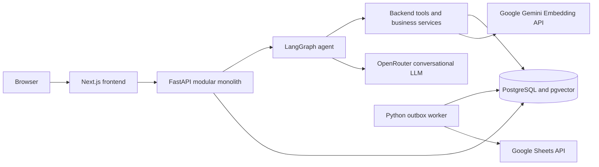
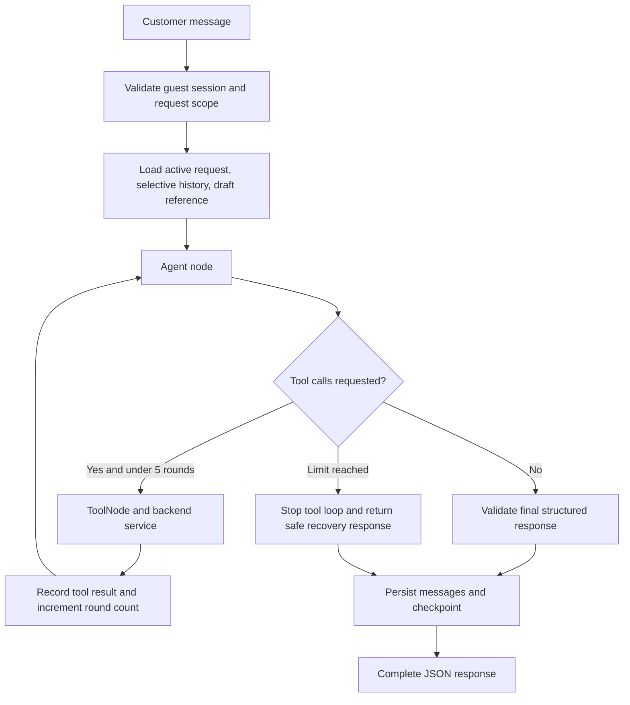
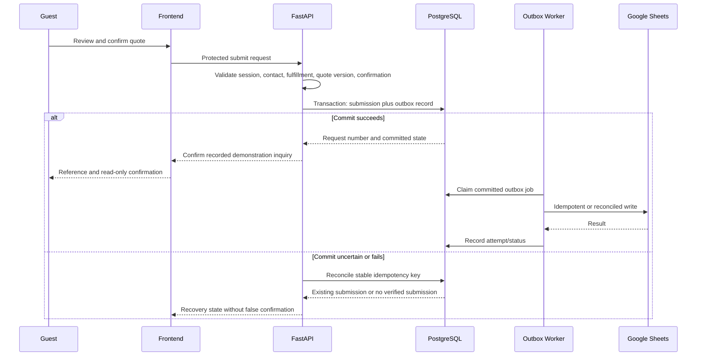

# 05 — System & AI Architecture

| Field | Value |
| --- | --- |
| Organization | Queens Tech Bros (QTB) |
| Project | BioMedicHospicare Medical Supply AI Assistant |
| Version | 1.0 |
| Status | Approved |
| Owner | QTB Product and Engineering |
| Date | 2026-11-04 |
| References | [PRD v1.2](01-product-requirements.md); [Conversation Flow Specification v1.1](02-conversation-flows.md); [Product Catalog & Inventory Baseline v1.0](03-product-catalog-inventory.md); [Business Operations & Knowledge Base Specification v1.0](04-business-operations.md) |

## 1. Purpose, constraints, and architecture stance

This document defines the implementation architecture for a portfolio-focused, pro bono, synthetic-data demonstration. It must demonstrate credible full-stack engineering without behaving as a live commerce, fulfillment, clinical-care, or customer-operations system. Catalog, stock, prices, quotations, customer records, and Google Sheets activity are synthetic demonstration data; no component may represent them as real BioMedicHospicare commercial operations.

The MVP uses a backend-heavy modular FastAPI monolith. This is intentionally simpler and cheaper than backend microservices: one deployable backend owns business rules, authorization, transactions, agent execution, and integrations; modules separate responsibilities inside that boundary. The expected workload, team size, and one downstream integration do not justify distributed deployment, service discovery, cross-service transactions, Celery, Redis, Kubernetes, or a separate vector database.

| Layer | Approved technology |
| --- | --- |
| Frontend | Next.js, React, TypeScript |
| Backend | Python, FastAPI |
| AI orchestration | LangGraph, LangChain |
| Conversational LLM gateway | OpenRouter |
| Model candidates | Gemini, Qwen, GPT-OSS |
| Embeddings | Google Gemini Embedding API |
| Primary data/vector store | PostgreSQL with pgvector |
| Background processing | PostgreSQL transactional outbox and lightweight Python worker |
| Deployment | Railway |
| Local development | Local services; Docker Compose where useful |
| Monitoring | Structured application logs and Railway logs |

## 2. System overview

The browser communicates with the FastAPI backend over standard HTTPS. The backend authenticates the opaque guest session, loads durable state, invokes LangGraph when conversational reasoning is needed, and executes all tools through deterministic Python services. The backend alone accesses PostgreSQL, external AI credentials, Gemini embeddings, and Google Sheets. One lightweight Python worker processes committed quotation and support outbox jobs through the same PostgreSQL-backed mechanism and never blocks customer responses.

| Component | Primary responsibility | Explicit boundary |
| --- | --- | --- |
| Next.js frontend | Guest UI, product cards, drafts, forms, loading/error/confirmation views, and limited presentation state. | Never authoritative for stock, price, identity, quote submission, or protected actions. |
| FastAPI modules | HTTP boundary, session authorization, validation, catalog/inventory, quote/support workflows, rate/budget controls, LangGraph runtime, and response validation. | Only backend modules may mutate business records or call protected integrations. |
| LangGraph agent | Interpret the active conversation context, select eligible tools, and produce a constrained final response. | It does not directly persist records, authorize actions, or calculate authoritative values. |
| PostgreSQL/pgvector | Durable business state, checkpoints, vector search, usage data, and outbox jobs. | Source of truth; no browser direct access. |
| Python worker | Safe asynchronous outbox processing and occasional operational tasks. | Does not alter customer confirmation outcomes. |

## 3. Frontend and backend responsibilities

The frontend renders predefined, validated response elements: assistant text, product collections, inventory notices, quote panels, confirmation prompts, and recoverable error states. It owns chat interaction, product-card pagination controls, draft quotation presentation, form interaction, accessibility, and transient UI state such as an open panel or pending visual action.

FastAPI owns business rules, data persistence, opaque guest-session authorization, catalog and inventory operations, LangGraph execution, tool execution, quote/support workflows, protected submissions, rate limiting, AI usage budget enforcement, and response validation. The frontend sends customer intent and requested UI action; the backend determines whether it is permitted and returns the authoritative state.

The frontend must not calculate final prices, infer current inventory, create request numbers, decide session access, or treat a local draft as a submitted quote. A UI Submit button and natural-language confirmation both invoke the same backend-protected workflow.

## 4. LangGraph conversation architecture

There is one tool-calling LangGraph agent, not a multi-agent system and not a separate LLM intent classifier. LangChain provides model/tool bindings, structured outputs, and retrieval integration. LangGraph provides agent state, checkpoints, conditional routing, tool-loop control, and workflow transitions.

For every customer message the backend validates session/request scope, loads only relevant context, invokes the agent, conditionally routes tool calls to `ToolNode` or an equivalent supported primitive, returns tool results to the agent, validates its final response, persists the turn/checkpoint, and returns complete JSON to the frontend.

The backend limits every customer message to **five tool execution rounds**. A round is one graph tool-execution cycle, even if the implementation later supports a constrained batch of compatible read-only calls. At the limit, the graph does not make another tool call; it persists available state and returns a safe, transparent response that asks the guest to narrow the request, resume on the next turn, or retry a temporary failure. It must not invent a result merely to finish the turn. If a protected operation may have reached PostgreSQL before the limit or an LLM/provider failure interrupts the turn, deterministic backend recovery must reconcile the committed database state by its stable idempotency key before a retry or customer-visible outcome.

## 5. Tool architecture and deterministic boundaries

Tool names remain aligned with Document 02. Each tool is a narrow adapter over a deterministic backend service; the LLM proposes an eligible action, while Python validates inputs, session/request scope, SKU resolution, versions, and persistence outcomes.

| Tool | Backend service responsibility | LLM may decide | Backend must decide |
| --- | --- | --- | --- |
| `search_products` | Structured filters plus semantic ranking and pagination. | Search phrasing and eligible filters. | Filter validity, result cap, ranking constraints, and no draft mutation. |
| `get_product_details` | Resolve public product/variant information. | Which resolved item to inspect. | SKU resolution and permitted fields. |
| `check_inventory` | Read current numeric synthetic stock and return categorical sufficiency. | When current availability matters. | Quantity validation, status, and count redaction. |
| `find_alternatives` | Validate up to three comparable alternatives. | Whether alternatives help. | Essential attributes, current stock, quantity, and safety boundaries. |
| `get_company_info` | Return approved structured business/demo facts. | Which fact is relevant. | Fact status, approval, and unknown-result behavior. |
| `search_knowledge_base` | Retrieve approved grounded policy passages. | Whether a knowledge question exists. | Approval filter, threshold, source metadata, and content boundaries. |
| `add_quote_item` | Add/merge a resolved variant line. | Explicit requested action after clarification. | SKU, sales-unit quantity, session draft, idempotency, and version update. |
| `update_quote_item` | Increment/replace a resolved draft line. | Explicit requested operation. | Target identity, quantity semantics, expected version, and persistence. |
| `remove_quote_item` | Remove one resolved draft line. | Explicit removal request. | Session ownership, line identity, idempotency, and final state. |
| `get_draft_quote` | Return authoritative draft and version. | When review/display is needed. | Session scope and public-safe representation. |
| `submit_quote_request` | Perform protected immutable quote submission. | Recognition of an explicit confirmation only. | Contact, fulfillment choice, review/version, disclosure, confirmation, transaction, and idempotency. |
| `submit_support_inquiry` | Perform protected immutable support submission. | Recognition of opt-in/confirmation only. | Consent, contact, summary review, transaction, and idempotency. |

The LLM must not independently calculate prices, fabricate availability, manufacture alternatives, infer real business policy, bypass confirmation, or invoke Google Sheets. Protected submission tools are exposed only through graph states that hold a valid reviewed action; their services revalidate state regardless of the model's request.

## 6. OpenRouter and model configuration

OpenRouter is the single initial gateway for conversational LLM requests. Model identifiers are configurable backend settings, not frontend values. Gemini, Qwen, and GPT-OSS are evaluation candidates; one selected candidate serves an individual conversation or evaluation run. The MVP does not perform automatic model routing, fallback roulette, or model-by-model retries that change behavior unexpectedly.

| Control | Architecture requirement |
| --- | --- |
| Provider abstraction | A backend model adapter isolates OpenRouter/LangChain invocation from business services, so provider/model replacement does not rewrite quote or catalog logic. |
| Model selection | Explicit configured model ID per conversation/evaluation run; tool-calling and structured-output compatibility are required before selection. Do not assume a specific identifier or free-tier availability. |
| Credentials | OpenRouter credentials are backend-only secrets; no browser exposure or logging. |
| Limits | Configurable response-token and context limits; per-session/global rate controls and daily AI budget. |
| Measurement | Record model ID, latency, input/output token counts when available, estimated cost, tool rounds, outcome/error class, and correlation ID. |
| Failure | Provider timeout, invalid tool call, malformed response, quota error, or unavailable model returns a safe retry/recovery state without false success. |

Google Gemini Embedding API is used separately for embeddings and does not imply that Gemini is the selected conversational model.

## 7. Conversation memory and context management

PostgreSQL is the durable source of truth. Guest sessions use opaque credentials and restore only in the same valid browser session within the rolling seven-day inactivity window. Server-side session checks prevent a draft ID, request ID, or checkpoint reference from authorizing another session's data. Session expiration invalidates protected conversational restoration; it does not automatically delete already submitted quotation requests or support inquiries. Retention of those immutable records is a separate backend policy.

Conversation state maintains one active request plus up to four saved resumable request contexts, for five total. Each context can hold filters, selected SKU, requested quantity, compact relevant summary, display topic, and an unanswered clarification. Natural-language references resume contexts; no saved-topic UI chips, topic tabs, threads, or topic-navigation sidebar are exposed. `request_order` supports LRU eviction: a new topic at capacity removes the least-recently-used inactive request, never the active request; every activation/resumption becomes most recent.

Persistent messages and LangGraph checkpoints enable recovery, but prompts receive selective recent messages, the active request summary, relevant pending action, and limited saved-topic metadata—not full historical conversation dumps. Compact summaries are generated only when needed and are not authoritative catalog or inventory records. The active draft quotation is stored independently in PostgreSQL and referenced by ID; topic switching cannot mutate it unless an explicit validated quote operation succeeds.

## 8. PostgreSQL persistence architecture

The following are logical data domains, not a final SQL schema.

| Domain | Purpose and integrity boundary |
| --- | --- |
| Guest sessions | Opaque credential metadata, expiry, and server-side authorization scope. |
| Messages and checkpoints | Durable conversation messages and LangGraph checkpoint/state recovery. |
| Request contexts | Active/saved request summaries, LRU order, and request-bound pending action metadata. |
| Catalog, variants, inventory | Synthetic source of truth for SKU, price, status, compatibility, and numeric stock. |
| Draft quotations | One persistent active draft/session, line identities, expected version, and mutation idempotency evidence. |
| Submitted quote requests | Immutable confirmed quotation payload, request number, contact/fulfillment snapshot, and submission key. |
| Support inquiries | Immutable consented support record, summary, and submission key. |
| Knowledge documents/chunks/embeddings | Approval state, provenance, model/version, chunk metadata, vector, and deactivation state. |
| Transactional outbox | Committed downstream Google Sheets job intent for submitted quotation requests and confirmed support inquiries, with stable identifiers, job type, attempts, status, and reconciliation data. |
| AI usage/budget | Aggregated session/global usage, configured budget checks, and observability metrics. |

Transactions group business changes that must agree: draft mutation and version update; immutable submitted quotation request and its outbox creation; and immutable confirmed support inquiry and its outbox creation. Each protected submission creates its business record and corresponding durable synchronization job in the same PostgreSQL transaction. Optimistic version checks prevent lost draft/review changes. Stable idempotency keys prevent repeated protected confirmation from producing multiple submissions. Concurrency, lock/claim behavior, indexes, retention mechanics, and the full SQL schema belong in Document 07.

## 9. RAG architecture

RAG uses PostgreSQL + pgvector and Google Gemini embeddings. The six future knowledge documents are KB-01 Company Overview, KB-02 Business Hours & Contact, KB-03 Shipping & Delivery, KB-04 Quotations & Bulk Orders, KB-05 Local Pickup, and KB-06 Customer Support & Policies, as defined in Document 04. They are not created by this architecture document.

### Ingestion

1. A knowledge source is reviewed, fact-status tagged, and approved.
2. Its content is split into useful chunks that retain policy conditions and source context.
3. The backend generates embeddings through the Gemini Embedding API.
4. PostgreSQL stores document/chunk metadata, approval state, embedding-model version, vector, and stable citation fields.
5. Changed approved documents are reindexed; superseded chunks are deactivated rather than silently treated as current.

### Retrieval

1. The agent identifies a policy/knowledge question; structured facts use `get_company_info` instead.
2. The backend generates a query embedding.
3. pgvector searches **approved** chunks only.
4. The MVP retrieves one initial relevant chunk (`RAG_TOP_K=1`).
5. A relevance threshold gates the result.
6. The agent receives the grounded excerpt, source title/ID, approval state, and chunk identifier.
7. It returns a sourced answer or abstains when evidence is insufficient.

The MVP does not automatically expand to more chunks after a low-confidence result. Embedding model/version and vector dimensional compatibility are stored and validated together; changing models requires a deliberate reindex rather than mixing incompatible vectors.

## 10. Structured response architecture

The system uses standard non-streaming HTTP request/response communication. After a turn completes, FastAPI returns complete validated JSON rather than token streaming. The response envelope may contain assistant text and only backend-approved predefined elements: product result collections, inventory notices, quotation panels, confirmation prompts, and error/recovery states.

The LLM is constrained to text and validated structured intent/result fields. It cannot emit executable frontend code, arbitrary HTML, JavaScript, or unrestricted React components. FastAPI validates all allowed response structures before return; the frontend renders only its predefined component mapping. Exact Pydantic models/API contracts belong in Document 07, while React implementation and TypeScript interfaces belong in Document 06.

## 11. Quotation submission architecture

Quotation lifecycle: discover products; resolve SKU/variant; add/edit/remove draft lines; validate current SKU, sales-unit quantity, price, stock, and warning state; review authoritative draft; select delivery or local pickup; collect required demo contact data; obtain explicit confirmation; execute a protected transaction; persist immutable submission and durable outbox record; then return a unique confirmation.

The transaction never reserves/decrements stock, creates payment, or promises fulfillment. Expected draft-version checks invalidate stale review confirmations. Duplicate confirmation resolves through a stable submission key. If a client response is lost after commit, a repeat reconciliation can return the existing immutable request. If commit outcome is uncertain, the backend reconciles before retry; it never blindly creates another submission or claims success before verified PostgreSQL persistence. Google Sheets status is never presented as customer-submission success.

## 12. Background processing and the transactional outbox

A lightweight Python worker polls committed PostgreSQL outbox jobs. Both supported job types use the same worker and PostgreSQL-backed processing mechanism:

- `QUOTE_SHEETS_SYNC` for a submitted quotation request, targeting the quotations tab.
- `SUPPORT_SHEETS_SYNC` for a confirmed support inquiry, targeting the separate Support Inquiries tab.

These are proposed architectural names, not mandatory final enum values. Each protected-submission transaction writes its immutable business record and corresponding durable Google Sheets synchronization job in the same commit. The worker discovers pending work, safely claims/locks a bounded batch, records attempts, performs the Sheets operation using the submission type's stable identifier, and marks success only after a known result or reconciliation.

Retries use bounded backoff and implementation-time attempt limits. For either job type, a failed or ambiguous write remains visible as a terminal or recoverable failure according to its recorded status; automatic retries must not blindly create duplicate rows. Stable identifiers, idempotent writes where supported, and reconciliation protect against duplicates. Worker interruption or restart recovers unclaimed or expired claims from PostgreSQL. Customer responses remain nonblocking because confirmation depends on committed PostgreSQL state, not Sheets.

Occasional knowledge indexing and session-expiry cleanup can be worker/operational tasks using the same simple deployment pattern. They do not require Celery, Redis, or separate queue infrastructure.

## 13. Error handling and recovery

| Failure class | Required behavior |
| --- | --- |
| Read-only tool failure | May retry once when safe; return clear unavailable/retry state without treating missing data as out of stock. |
| Draft mutation failure | Do not blindly replay uncertain change; reconcile idempotency/persisted draft, then return the authoritative version. |
| Protected submission failure | Never blindly retry an uncertain outcome; reconcile committed state by stable submission identifier before any retry or result, including when the graph stops at its tool-round limit. |
| LLM/OpenRouter failure | Preserve safe conversation/draft state, return non-misleading retry/recovery message, and reconcile any protected operation that may have committed before the provider failure; do not claim tool action succeeded without verified state. |
| Embedding failure | Do not fabricate RAG answer; state knowledge lookup is temporarily unavailable or abstain. Structured facts remain separately available. |
| PostgreSQL failure | Reject/hold protected action and return no-success state; no customer confirmation until verified commit. |
| Sheets failure | For quotation or support synchronization, persist observable job failure/retry state; do not invalidate the already committed PostgreSQL record or its valid customer confirmation. |
| Rate/budget exhaustion | Stop provider invocation, preserve state, give a safe availability message, and emit observability data. |

## 14. Security and cost controls

Security is backend-enforced and proportional to a public demonstration: opaque session credentials; session-scoped authorization; validated inputs; restricted tools; response-schema validation; prompt-injection isolation; backend-only secrets; privacy-conscious logs; rate limits; per-session/global AI caps; and configurable daily AI budget.

Context-window limits, response-token limits, and the five-round tool cap bound cost and looping. Tool permissions prevent the model from authorizing payment, inventory changes, direct Sheets access, submitted-record edits, or policy creation. Logs use request/session correlation IDs and avoid secrets, customer contact details, and full private conversation content. The synthetic-demo disclosure is shown at appropriate submission/commitment points; it does not authorize collecting unnecessary sensitive data.

The MVP deliberately excludes customer accounts, full authentication, complex RBAC, and additional security infrastructure. These are not replaced by model prompts; server validation is the authority.

## 15. Deployment architecture

Railway is the proposed public demonstration environment. Logical services are a Next.js frontend, FastAPI backend, PostgreSQL instance with pgvector capability, and lightweight Python outbox worker. Service connectivity uses private configuration/environment variables where Railway supports it; all secrets remain server-side. Health checks should verify each HTTP service is alive and can report dependency health without exposing credentials or private data.

Database migrations run as a controlled deployment operation, not from browsers or ad hoc runtime paths. Local and Railway databases remain separate. Local development uses local services and Docker Compose where useful; production configuration must not be copied into local credential files. Hosting costs and free-tier availability are not assumed.

Git workflow is `feature/*` → `dev` → `main`: `dev` is the local integration/testing branch, `main` is the stable branch connected to Railway deployment, and no separate paid staging environment is initially required.

## 16. Testing, evaluation, and observability

| Area | Scope |
| --- | --- |
| Unit tests | Deterministic business rules, validation, quantity semantics, compatibility, idempotency helpers, and state transitions. |
| Integration tests | FastAPI/services with PostgreSQL transactions, catalog/inventory, protected submissions, both outbox job types, duplicate prevention, Sheets-failure recovery, and authorization boundaries. |
| Frontend component tests | Product cards, draft/confirmation/error presentation, pagination, keyboard behavior, and form state. |
| End-to-end tests | Guest session restoration, discovery-to-quote, quotation Sheets synchronization, fulfillment selection, support opt-in and Support Inquiries synchronization, duplicate confirmation, and failure recovery. |
| AI evaluation | Approximately 65 reproducible scenarios covering tool selection, completion, grounding, confirmation safety, safety boundaries, and recovery. |

Equivalent evaluation scenarios compare the three configured model candidates. Record tool-selection accuracy, workflow completion, grounded-response quality, confirmation safety, latency, token use, estimated cost, and failure/recovery behavior. Protected-action safety is a mandatory release gate independent of any aggregate model score. Deterministic tests run through CI; the full paid AI evaluation suite is run deliberately, not on every commit.

Structured Python logs, Railway logs, request/session correlation IDs, PostgreSQL AI-usage records, and outbox job status provide MVP observability. Track error class, request latency, tool rounds, selected model, token/cost estimates, retry state, job status, and daily budget utilization. Do not add Prometheus, Grafana, paid tracing, secrets, contact details, or full private conversations to logs.

## 17. Boundaries and implementation follow-up

This document covers system architecture. Document 06 will cover frontend implementation design; Document 07 will cover backend/API, Pydantic, SQL, transaction, and service-interface detail; and Document 08 will cover the development roadmap.

Open implementation-time decisions include final OpenRouter model identifiers, response/context limits, relevance threshold, pgvector/index configuration, exact rate/budget values, worker polling/claim parameters, schema/migration approach, Railway service settings, and health-check detail. These are recommendations to resolve during Documents 06–08 or implementation planning, not approved product commitments.

## 18. Architecture review checklist

- The design retains one LangGraph tool-calling agent and approximately twelve tools.
- OpenRouter is the initial conversational LLM gateway; Gemini is used for embeddings.
- PostgreSQL/pgvector is authoritative; no separate vector database, Celery, Redis, Kubernetes, or microservices are introduced.
- Protected submissions are backend-controlled, transactionally persisted, idempotent, and confirmed only after verified PostgreSQL commit.
- Google Sheets synchronization for submitted quotation requests and confirmed support inquiries is asynchronous through the transactional outbox and processed by the same worker.
- The system uses standard complete JSON HTTP responses, not streaming.
- The design preserves synthetic-data, safety, privacy, session, catalog, quote, support, and RAG boundaries from Documents 01–04.
- This approved architecture baseline does not represent production deployment, live commerce, or real business operations.
