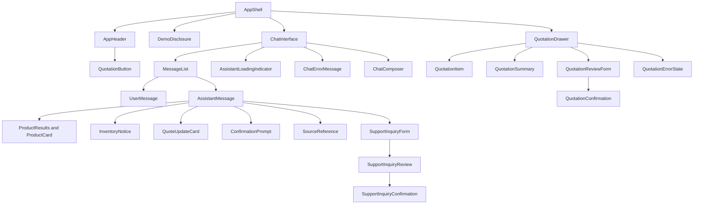
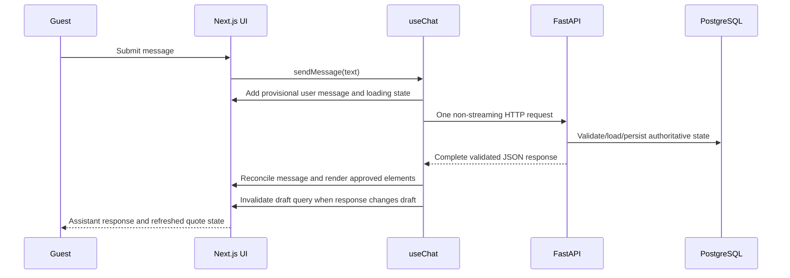

# 06 — Frontend Implementation Design

| Field | Value |
| --- | --- |
| Organization | Queens Tech Bros (QTB) |
| Project | BioMedicHospicare Medical Supply AI Assistant |
| Version | 1.0 |
| Status | Approved |
| Owner | QTB Product and Engineering |
| Date | 2026-11-04 |
| References | [PRD v1.2](01-product-requirements.md); [Conversation Flow Specification v1.1](02-conversation-flows.md); [Product Catalog & Inventory Baseline v1.0](03-product-catalog-inventory.md); [Business Operations & Knowledge Base Specification v1.0](04-business-operations.md); [System & AI Architecture v1.0](05-system-ai-architecture.md) |

## 1. Purpose and boundaries

This document defines the implementation design for the guest-facing frontend. It is a light-mode-first, minimalist, ChatGPT-style assistant for a synthetic-data portfolio demonstration—not an ecommerce storefront, checkout, customer dashboard, or real-business system.

FastAPI, PostgreSQL, and LangGraph remain authoritative for business rules, session authorization, catalog facts, inventory, quotation state, protected submissions, and conversational reasoning. The browser renders only validated, backend-approved structured response elements; it never accesses the database, treats a local calculation as authoritative, or interprets arbitrary LLM HTML, code, or components.

The frontend presents one continuous conversation in a valid guest session. Backend request contexts remain internal: the UI has no sidebar, chat-history list, visible topic chips, or separate chat threads. A guest may submit a quotation and create a later draft in the same conversation, subject to the existing session and immutable-submission rules.

## 2. Approved stack and design principles

| Concern | Approved technology and responsibility |
| --- | --- |
| Framework and language | Next.js App Router with React and TypeScript strict mode. |
| Styling and components | Tailwind CSS and shadcn/ui, customized through theme tokens rather than broad custom CSS. |
| Server state | TanStack Query; FastAPI/PostgreSQL remains authoritative. |
| Local UI state | `useState` and `useReducer`; narrowly scoped React Context only for genuinely shared presentation concerns. |
| Chat interaction | Custom `useChat` hook composed from TanStack Query queries and mutations. |
| Forms | React Hook Form with Zod and `zodResolver`; FastAPI/Pydantic independently validates all submissions. |
| API contracts | `openapi-typescript` generated types from FastAPI OpenAPI; UI-only types remain hand-written. |
| Feedback and testing | Sonner, Vitest with React Testing Library, and Playwright. |
| Deployment boundary | Next.js frontend and FastAPI backend on Railway, as defined by Document 05. |

Do not add Redux, Zustand, another form library, an additional component system, a client-side database, or a second server-state cache. There is no token streaming or SSE in this MVP: every chat turn receives one complete validated JSON response.

## 3. Experience, layout, and visual system

### 3.1 Application shell

The page contains a compact branded header, a centered continuous message area, a persistent message composer, and a quotation button that opens the current draft. Assistant messages can render text plus approved rich elements inline. A desktop quotation drawer is non-modal where practical so chat remains usable; mobile uses an appropriately sized overlay or full-screen panel and preserves the draft/review form when returning to chat.

The application deliberately excludes a left sidebar, catalog page, checkout page, visible request-topic controls, accounts, or a customer dashboard. Natural-language conversation is the only customer-facing way to change conversational topics.

### 3.2 Branding and logo handling

No BioMedicHospicare logo file currently exists in this repository. The project owner must supply an authorized logo and recorded usage permission before implementation/public use. The recommended future location is `frontend/public/brand/biomedichospicare-logo.<approved-extension>`, with a semantic `alt="BioMedicHospicare"` value.

Until supplied, render a text fallback—`BioMedicHospicare`—inside the compact header rather than recreating an official mark. The header also shows `AI Supply Assistant`, a concise synthetic-demo disclosure, and a quotation button with the committed draft-line count.

### 3.3 Proposed tokens

These values are proposed interface tokens, not verified official logo specifications. The final brand palette must be sampled or approved from the supplied logo before implementation.

| Token group | Proposed value or rule |
| --- | --- |
| Primary / secondary | `brand-600` around a medical blue; `brand-700` around a dark blue/slate for emphasis. |
| Text | Slate-based strong, default, and muted text tokens with accessible contrast on white. |
| Surfaces | White page/surface, very light cool-gray canvas, subdued hover surface. |
| Status | Semantic green success, amber warning, and red error; never color alone as the signal. |
| Borders and shadows | Light neutral border, `rounded-md`/`rounded-lg`, and restrained low-elevation shadows. |
| Spacing | Tailwind 4-point scale; chat vertical rhythm favors `gap-4` to `gap-6`. |
| Typography | System sans stack, readable base body size, compact labels, clear heading hierarchy. |
| Motion | Short, optional transitions; honor `prefers-reduced-motion`. |

Use CSS variables/theme configuration consumed by Tailwind and shadcn/ui. Light mode is the only MVP requirement.

## 4. Recommended directory architecture

```text
frontend/
  src/
    app/
      layout.tsx
      page.tsx
      providers.tsx
    features/
      chat/
        components/
        hooks/
        types/
      products/
        components/
        hooks/
      quotation/
        components/
        hooks/
        validation/
      support/
        components/
        hooks/
        validation/
      session/
        hooks/
    components/
      ui/
      layout/
    lib/
      api/
        client.ts
        schema.d.ts
      query/
        query-client.ts
        query-keys.ts
      utils/
    styles/
```

`app/` owns App Router composition and providers, not business logic. `features/` groups feature-local components, hooks, validation, and UI types. `components/ui/` holds shadcn/ui primitives; `components/layout/` holds small reusable shell pieces. `lib/api/` holds the typed HTTP wrapper and generated OpenAPI declarations; `lib/query/` owns query client/key conventions. `styles/` contains only global Tailwind/theme concerns.

Avoid a generic `services/` dumping ground, duplicated feature API clients, circular imports, and files that exist solely to wrap a trivial constant. Import generated contract types into features; do not copy their schemas into separate frontend interfaces.

## 5. Component hierarchy



### 5.1 Component inventory

| Component | Responsibility and data | State/interactions | Accessibility and tests |
| --- | --- | --- | --- |
| `AppShell` | Composes header, disclosure, chat, and drawer; receives no business data directly. | Drawer open state only. | Landmark layout; test shell composition. |
| `AppHeader` / `DemoDisclosure` | Displays authorized logo or text fallback, assistant name, concise synthetic-data disclosure, and draft count. | Quotation button opens drawer. | Accessible logo label/button name; test fallback and count. |
| `ChatInterface` | Owns `useChat`, initial restoration, message region, composer, and inline structured responses. | Send pending/error, scroll intent. | `main`/log semantics; test send, recovery, restoration. |
| `MessageList`, `UserMessage`, `AssistantMessage` | Renders ordered persisted/provisional messages. `AssistantMessage` maps approved response elements only. | No independent conversation copy. | New assistant content announced politely; test order and unknown-element rejection. |
| `ChatComposer` | Multiline text input and send control. | Draft text, composition state. | Label, keyboard handling, disabled duplicate submit; test Enter/Shift+Enter. |
| `AssistantLoadingIndicator` / `ChatErrorMessage` | Communicate in-progress and recoverable failure state. | Retry delegates to `useChat` only when safe. | `role=status`/actionable error; test focus and wording. |
| `ProductResults` / `ProductCard` | Render up to five server-returned products, Show More, and variant/SKU detail. | Card-action pending state only. | Button labels include product/SKU; test pagination and image fallback. |
| `InventoryNotice`, `QuoteUpdateCard`, `ConfirmationPrompt`, `SourceReference` | Render approved notice, quote mutation result, protected-action prompt, and grounded source metadata. | Confirmation follows backend state gate. | Warning semantics, source label, no false success; test each element. |
| `QuotationButton`, `QuotationDrawer` | Open/close current authoritative draft, retaining review form state while UI is hidden. | Panel/view mode and narrow UI state. | Non-modal desktop panel; mobile dialog focus restoration; test open/close. |
| `QuotationItem` / `QuotationSummary` | Render line, public warning, indicative price, total supplied/calculated only from server values, and remove/edit control. | Per-line pending display. | Quantity labels and remove names; test stale/refetch state. |
| `QuotationReviewForm`, `QuotationConfirmation`, `QuotationErrorState` | Collect/review contact and fulfillment, show success only after response verification, and show recoverable state. | RHF values, review state, protected mutation pending. | Field errors, disclosure, explicit confirm control; test invalidation/cancel/reconciliation. |
| `SupportInquiryForm`, `SupportInquiryReview`, `SupportInquiryConfirmation` | Collect opt-in inquiry, present summary, and confirm persistence result. | RHF values and review state. | Clear cancellation and no-staff-contact disclosure; test consent and preservation of draft. |

Representative UI contracts use generated API types once Document 07 exposes them. Names below are illustrative placeholders only.

```ts
type AssistantElement =
  | { kind: "product_results"; resultSet: ApiProductResultSet }
  | { kind: "inventory_notice"; notice: ApiInventoryNotice }
  | { kind: "quote_update"; quote: ApiDraftQuote }
  | { kind: "confirmation_prompt"; prompt: ApiConfirmationPrompt }
  | { kind: "source_reference"; source: ApiSourceReference }
  | { kind: "support_form"; state: ApiSupportFormState };

interface AssistantMessageProps {
  message: ApiConversationMessage | ProvisionalAssistantMessage;
  elements: AssistantElement[];
  onAction(action: ApprovedUiAction): void;
}

interface ProductCardProps {
  product: ApiProductCard;
  onAddToQuote(input: AddToQuoteIntent): void;
  onSelectVariant?(selection: ProductSelectorValue): void;
  isActionPending?: boolean;
}

interface AddToQuoteIntent {
  sku: string;
  /** Present only when the guest explicitly supplied a positive whole selected-sales-unit quantity. */
  requestedQuantity?: number;
}
```

## 6. Chat interaction and `useChat`

### 6.1 Message lifecycle



The composer inserts a provisional, clearly local user message immediately. While a turn is pending, sending is disabled to prevent accidental duplicate chat requests; text may remain editable for the next turn only after completion. The UI displays a concise processing indicator, sends one request to FastAPI, reconciles the provisional item with a backend message identifier when returned, renders the validated response, then refreshes quote state when indicated.

On a network timeout or lost response, the UI must say that the outcome is unknown—not that the operation failed. It must not automatically replay a request that could have mutated a draft or submitted a protected record. It requests/retrieves authoritative state through the approved backend path before offering a safe retry.

Message list behavior: keep the latest turn visible after a send or received response unless the guest has intentionally scrolled upward; expose a "new messages" affordance if needed. Focus remains in the composer after a successful send. `Enter` submits when not composing text; `Shift+Enter` inserts a newline. The composer has a visible label/instruction and supports IME composition.

### 6.2 `useChat` contract

```ts
interface UseChatResult {
  messages: RenderableMessage[];
  isRestoring: boolean;
  isSending: boolean;
  error: ChatRecoveryError | null;
  sendMessage(input: { text: string }): Promise<void>;
  retryReadOnlyTurn(): Promise<void>;
  clearRecoverableError(): void;
}

function useChat(): UseChatResult {
  // Illustrative composition: useQuery for history/session,
  // useMutation for one submitted turn, and query invalidation for draft state.
  throw new Error("Design contract only");
}
```

`useChat` composes TanStack Query. It reads session/conversation server state through queries, sends the turn through a mutation, holds only provisional display state locally, reconciles returned messages, and invalidates the authoritative draft cache when the response declares a committed quote change. It does not create a competing server-data cache or maintain unbounded duplicate conversation history. Restoration occurs from valid backend session state; it does not reconstruct protected state from browser IDs.

## 7. TanStack Query and API state

`QueryClientProvider` belongs in `app/providers.tsx`. Query keys are centralized, serializable, and scoped to the authenticated opaque guest-session context supplied by the browser transport—not a manually exposed session secret.

```ts
export const queryKeys = {
  session: ["guest-session"] as const,
  conversation: ["conversation"] as const,
  draftQuote: ["draft-quote"] as const,
  productSearch: (input: ProductSearchInput) => ["product-search", input] as const,
  product: (sku: string) => ["product", sku] as const,
};
```

| State | Query approach |
| --- | --- |
| Session and conversation history | `useQuery` restores/refetches on page load and after explicitly recoverable state. Keep stale server data visible while `isFetching` unless session validity is unknown. |
| Draft quotation | `useQuery` drives header count, drawer, inline quote cards, and review. Invalidate after verified quote mutations or chat response indicating changed authoritative draft. |
| Product search/details | `useQuery` for backend-provided, filter/cursor-specific result sets. Show More keeps prior cards and cursor context. Fresh inventory claims require backend revalidation. |
| Chat and protected actions | `useMutation`; `isPending` disables the originating action. Do not blindly retry mutations or submissions. |

Use `isPending` for initial query/mutation work that has no usable result, `isFetching` for background refetches with cached content, and mutation-specific pending flags for a card/line/confirmation control. A successful mutation may set returned authoritative draft data and invalidate dependent keys; invalidation is preferable when the response does not include a complete trusted draft. Never locally calculate an authoritative total, stock count, quote version, submission reference, or final outcome.

## 8. Product discovery and card behavior

Cards appear only inside `AssistantMessage` response elements. Each displays image or fallback, product name, selected variant or required selector, sales unit/package size, SKU when resolved, indicative USD price, and public categorical availability. Private numeric stock is never included in DOM content, labels, tooltips, or analytics.

`ProductResults` displays no more than five cards per backend batch. A Show More control sends the backend cursor/filter context and appends returned cards without replacing prior results. When a parent product has unresolved required variants, the card exposes selectors only if the backend declares eligible options; otherwise it asks the guest to clarify. It never guesses a sellable SKU.

Both card Add to Quote and natural-language instructions call the same backend quote workflow. `requestedQuantity`, when present, must be a positive whole number of the selected SKU's sales unit and is independently validated by FastAPI. The approved requirements do not establish a default card-add quantity. Until that UX decision is approved, an Add to Quote action without an explicit quantity must request/select a quantity or delegate to the backend clarification workflow; it must not silently assume `1` or mutate the draft. A card action shows a pending state, then a server-confirmed success/update or recoverable error. On mobile, cards remain readable in a single column with action controls at least touch-target size; horizontal scrolling is not the primary card interaction.

## 9. Quotation drawer, review, and submission

The header button shows the committed line count and opens `QuotationDrawer`. On desktop it is a right-side non-modal panel so the chat remains usable. On mobile it is an overlay or full-screen view with an explicit return-to-chat control. Closing or switching views preserves unsent form values and review state locally; it never changes the server draft.

The drawer reads one authoritative draft query and renders `QuotationItem` rows, availability warnings, indicative prices, server-supplied indicative total where available, and review action. Direct quantity/remove controls use the same backend mutations as chat. Quantities are positive whole numbers of the selected SKU sales unit; the UI asks for clarification rather than converting an ambiguous request such as individual gloves into boxes.

Concurrent chat/drawer changes invalidate the review version. While a line mutation is pending, disable conflicting controls for that line and present current data as potentially refreshing. If the backend reports a version conflict or stale review, retain entered contact/fulfillment fields, explain the changed draft, refresh it, and require a new review/confirmation.

### 9.1 Review flow

1. Refetch/retrieve the authoritative draft and display products, warnings, and indicative values.
2. Collect first name, last name, and at least one valid email or phone.
3. Collect Delivery or fictional Cali local pickup; Delivery requires a destination city and only necessary detail.
4. Display the demo/privacy disclosure, including no real order, payment, reservation, or fulfillment promise.
5. Present review details and explicit confirmation.
6. Invoke the protected FastAPI workflow only from the valid review state.
7. Show a unique reference only after verified PostgreSQL commit; clear the active draft and retain chat.

Cancellation exits review without deleting the draft. A submitted quotation stays immutable; later changes require a new inquiry or support workflow. A successful PostgreSQL response may say the demonstration inquiry was recorded, never that an order was accepted or Sheets sync succeeded.

```ts
interface QuotationDrawerProps {
  open: boolean;
  onOpenChange(open: boolean): void;
  draft: ApiDraftQuote | undefined;
  isDraftLoading: boolean;
  onUpdateLine(input: QuoteLineChange): Promise<void>;
  onRemoveLine(lineId: string): Promise<void>;
}

interface QuotationReviewFormProps {
  draftVersion: string;
  initialContact?: SessionPermittedContact;
  onCancel(): void;
  onSubmitReview(input: QuotationReviewInput): Promise<void>;
}
```

## 10. Support inquiry interface

Support is shown only after the guest initiates it or explicitly accepts an assistant offer. `SupportInquiryForm` collects first name, last name, at least one email/phone, and a concise inquiry description. It may offer same-valid-session contact reuse only when the guest explicitly confirms reuse.

`SupportInquiryReview` displays the summary, demo disclosure, and an explicit confirmation. The protected submission comes from FastAPI; after verified PostgreSQL persistence, `SupportInquiryConfirmation` shows a demonstration reference without promising real staff contact. Sheets synchronization is asynchronous through the backend worker and does not affect confirmation. Decline or cancellation preserves the chat and unrelated quotation draft.

## 11. React Hook Form and Zod

Client validation improves interaction but is not a security boundary. FastAPI/Pydantic repeats validation and remains the authority.

```ts
const phoneSchema = z
  .string()
  .trim()
  .regex(/^\+?[0-9(). -]{7,}$/, "Enter a valid phone number.");

const quotationReviewSchema = z
  .object({
    firstName: z.string().trim().min(1),
    lastName: z.string().trim().min(1),
    email: z.string().trim().email().optional().or(z.literal("")),
    phone: phoneSchema.optional().or(z.literal("")),
    fulfillment: z.enum(["delivery", "local_pickup"]),
    destinationCity: z.string().trim().optional(),
  })
  .superRefine((value, context) => {
    if (!value.email && !value.phone) context.addIssue({ code: "custom", path: ["email"], message: "Provide an email or phone number." });
    if (value.fulfillment === "delivery" && !value.destinationCity) context.addIssue({ code: "custom", path: ["destinationCity"], message: "Destination city is required for delivery." });
  });

const supportInquirySchema = z
  .object({
    firstName: z.string().trim().min(1),
    lastName: z.string().trim().min(1),
    email: z.string().trim().email().optional().or(z.literal("")),
    phone: phoneSchema.optional().or(z.literal("")),
    description: z.string().trim().min(1).max(/* implementation-time limit */ 1000),
  })
  .superRefine((value, context) => {
    if (!value.email && !value.phone) context.addIssue({ code: "custom", path: ["email"], message: "Provide an email or phone number." });
  });
```

Use `useForm` with `zodResolver`, field-level error messages tied through `aria-describedby`, and `watch("fulfillment")` to conditionally render the delivery city. Both schemas enforce the same at-least-one-contact cross-field rule. Preserve form values in the drawer feature while it is temporarily hidden; clear them only after cancel, confirmed success, session expiry, or an explicit user reset. Exact length, phone, and backend constraints remain Document 07 contract decisions.

## 12. Generated API types and typed client

FastAPI owns OpenAPI contracts. Once Document 07 defines them, generate types into `src/lib/api/schema.d.ts` with `openapi-typescript`; do not create placeholder generated files now. A typed `client.ts` wraps transport, session credential behavior, parsing, correlation/error normalization, and contract imports. It does not embed endpoint literals throughout components.

| Concern | Design rule |
| --- | --- |
| Generation | Regenerate from approved FastAPI OpenAPI during deliberate contract update/CI checks. |
| Generated types | Represent backend requests/responses only; import them using stable aliases. |
| UI types | Define local presentational state such as drawer mode or provisional message separately. |
| Contract change | Update Document 07/OpenAPI, regenerate types, type-check frontend, then update affected feature tests. |
| Unknown contracts | Use clearly marked illustrative names in this document only; do not invent endpoint paths or final schemas. |

## 13. Error handling and feedback

| Pattern | Use | Required behavior |
| --- | --- | --- |
| Field-level | React Hook Form/Zod fields. | Explain invalid contact, missing destination city, or description errors near the field. |
| Action-level | Sonner for concise reversible action feedback. | Avoid a toast as the only error/confirmation representation for protected submissions. |
| Critical/recoverable | Inline chat/drawer state. | Explain next safe action without raw errors, stack traces, or false failure/success claims. |

Product unavailability, inventory changes, stale quote versions, expired sessions, API timeout, OpenRouter/model availability, rate limits, daily AI budget, and Sheets delay all produce customer-safe states. A timeout does not prove a mutation failed. For uncertain draft actions, refresh/reconcile authoritative draft state before retry. For uncertain protected submissions, the backend must reconcile stable identifiers before the UI offers another submit action. A Sheets failure after PostgreSQL persistence does not revoke the submitted record or displayed reference.

## 14. Responsive design and accessibility

| Area | Requirement |
| --- | --- |
| Layout | Center a readable chat column on wide screens; use full available width with safe side padding on mobile. |
| Header | Keep logo/text, disclosure, and quotation count compact; preserve usable controls on narrow screens. |
| Cards/panel | One-column mobile product cards; desktop right panel; mobile overlay/full-screen drawer with focus return. |
| Keyboard | Tab-order follows visual flow; Enter/Shift+Enter composer behavior; operable drawer/card/confirm controls. |
| Screen readers | Label controls, announce loading/new assistant content, associate field errors, and use descriptive button names. |
| Focus and contrast | Visible focus ring, WCAG-conscious contrast, no color-only warning/error signal, minimum practical touch targets. |
| Motion | Respect reduced-motion preference and avoid motion that obscures state changes. |

No sidebar or visible topic chips may appear at any breakpoint. The UI must preserve chat input, drawer values, and review progress through layout changes and drawer navigation.

## 15. Testing strategy

| Layer | Scope |
| --- | --- |
| Vitest + React Testing Library | Chat provisional messages, loading/failure states, structured-response rendering, card actions, Show More, drawer state, line edits, cache synchronization, RHF/Zod validation, review invalidation, support consent, keyboard/focus behavior. |
| Hook tests | `useChat` provisional/reconciliation behavior, pending lockout, draft invalidation, read-only retry eligibility, and no unsafe automatic mutation retry. |
| Playwright | Synthetic end-to-end guest journey: search gloves, show cards, add product, open/edit drawer, continue chat while desktop drawer is open, review, confirm, see simulated reference, then create another draft. |

Playwright also covers seven-day restoration behavior through controllable fixtures, mobile drawer state preservation, repeated Submit clicks, stale review rejection, support opt-in/cancel, inaccessible inventory-data redaction, and recovery from mocked API/model/network failures. Component tests use synthetic fixtures and mocked integrations; they do not call a paid LLM.

## 16. Component contract appendix

| Component/hook | Props or result | Backend-derived data | UI-only state and events | Required states/tests |
| --- | --- | --- | --- | --- |
| `ChatInterface` | `initialSession?` | Conversation query, draft query. | `useChat`; drawer open callback. | Restore/loading/error; message ordering and announcement. |
| `ChatComposer` | `onSend`, `disabled`, `pending`. | None. | Text/composition; submit/clear. | Empty, pending, multiline, keyboard tests. |
| `AssistantMessage` | `message`, `elements`, `onAction`. | Validated response elements. | None beyond element action pending. | Text, each known element, unknown element fails safely. |
| `ProductCard` | `product`, `onAddToQuote`, `isActionPending`. | Card details and categorical availability. | Selector display/pending UI. | Fallback image, selector, add success/error, mobile. |
| `QuotationDrawer` | `open`, `onOpenChange`, `draft`. | Draft/version and line data. | Panel mode/review-form preservation. | Empty/loading/stale/mobile/focus-return. |
| `QuotationItem` | `line`, `onQuantityChange`, `onRemove`. | Server line warning/pricing. | Per-line pending/edit text. | Positive-unit validation, warning, conflict. |
| `QuotationReviewForm` | `draftVersion`, `initialContact`, callbacks. | Authoritative review/draft data. | RHF values and validation errors. | Delivery conditional city, cancel, stale version, explicit confirm. |
| `SupportInquiryForm` | `initialContact?`, `onReview`, `onCancel`. | Permitted session contact only. | RHF values/reuse consent. | Opt-in, required contact, cancel preserves draft. |
| `useChat` | See Section 6.2. | Session/history and response mutation. | Provisional message/loading/recovery UI only. | Pending lockout, reconciliation, cache invalidation, safe retry. |

## 17. Architectural boundaries and deferred backend dependencies

The frontend renders approved structured API output and delegates all facts and protected operations to FastAPI. It has no direct PostgreSQL access, frontend-only submission success state, LLM-generated UI execution, autonomous agent behavior, payment flow, storefront/checkout, real-business operation, or medical-treatment advice.

Document 07 must define the final FastAPI paths, Pydantic/OpenAPI schemas, browser session transport, exact response envelope, message and pagination identifiers, quote line/version contracts, error/reconciliation codes, rate-limit representation, and idempotency/transaction behavior. This document intentionally does not invent them.

Document 08 will sequence implementation, integrations, evaluations, acceptance milestones, and release readiness. Document 05 remains authoritative for system architecture; this document does not alter its OpenRouter, Gemini embeddings, PostgreSQL/pgvector, worker, Railway, or cost-control decisions.

## 18. Review checklist

- One continuous chat, no sidebar/history list/topic chips/catalog page/checkout/accounts.
- Desktop quotation drawer leaves chat usable; mobile panel preserves in-progress values.
- Product cards and drawer mutations use the same authoritative backend state and never show numeric stock.
- Review requires contact, fulfillment choice, delivery city when applicable, disclosure, and explicit confirmation.
- Submission confirmation follows verified PostgreSQL persistence only; Sheets sync remains asynchronous.
- `useChat` composes TanStack Query without a competing server-state cache or unsafe retries.
- OpenAPI-generated types are planned without fake API contracts.
- No frontend code, dependencies, deployment, or infrastructure are created by this document.
