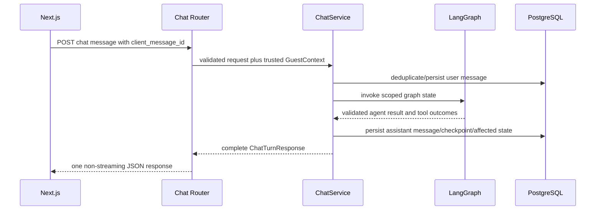
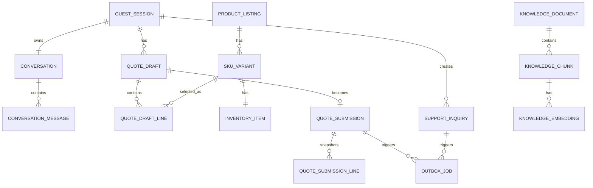
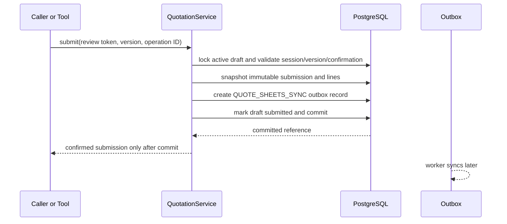

# 07 — Backend & API Design

| Field | Value |
| --- | --- |
| Organization | Queens Tech Bros (QTB) |
| Project | BioMedicHospicare Medical Supply AI Assistant |
| Version | 1.0 |
| Status | Approved |
| Owner | QTB Product and Engineering |
| Date | 2026-11-04 |
| References | [PRD v1.2](01-product-requirements.md); [Conversation Flow Specification v1.1](02-conversation-flows.md); [Product Catalog & Inventory Baseline v1.0](03-product-catalog-inventory.md); [Business Operations & Knowledge Base Specification v1.0](04-business-operations.md); [System & AI Architecture v1.0](05-system-ai-architecture.md); [Frontend Implementation Design v1.0](06-frontend-implementation-design.md) |

## 1. Purpose and implementation boundaries

This document specifies the proposed implementation design for the backend-heavy modular FastAPI monolith. It translates the approved product, flow, catalog, operations, architecture, and frontend baselines into proposed HTTP contracts, services, PostgreSQL data design, transaction ownership, and test responsibilities.

This is a synthetic-data demonstration. The backend must not create real orders, payments, inventory reservations/decrements, delivery commitments, clinical advice, or real-business notifications. PostgreSQL is authoritative for protected state. Google Sheets is an asynchronous downstream demonstration integration only.

Proposed paths, table names, Pydantic class names, error codes, indexes, and configuration variable names below are technical designs for review; they are not new business requirements. They must be reconciled with the final OpenAPI contract before code is written.

## 2. Approved stack and modular monolith

| Area | Approved technology/design |
| --- | --- |
| HTTP/API | Python, FastAPI, Pydantic, Pydantic Settings, versioned `/api/v1` routes. |
| Persistence | SQLAlchemy 2.0 async ORM, Alembic, psycopg 3, PostgreSQL and pgvector. |
| AI | LangGraph/LangChain, PostgreSQL checkpointer, OpenRouter conversational gateway, Gemini Embedding API. |
| Async work | One lightweight Python PostgreSQL-outbox worker and Google Sheets API. |
| Test/deploy | pytest, pytest-asyncio, HTTPX, Railway. |

No Redis, Celery, separate vector database, microservice fleet, external authentication provider, or complex monitoring platform is introduced. Routers parse HTTP concerns, services own business workflows/transactions, repositories contain non-trivial persistence queries, and LangGraph tools are thin adapters over the same services used by HTTP routes. A repository is not required for a trivial one-model operation; avoid abstraction layers that merely forward calls.

## 3. Directory architecture and ownership

```text
backend/
  app/
    main.py
    api/v1/
      sessions.py  chat.py  products.py  quotations.py  support.py
      dependencies.py  errors.py
    schemas/
    models/
    services/
    repositories/
    agents/
      graph.py  state.py  prompts.py
      tools/
    db/
      session.py  base.py  migrations_support.py
    core/
      settings.py  security.py  logging.py  rate_limits.py
    workers/
      outbox.py  sheets.py
    dev/
      mock_chat.py  fixtures/
  alembic/
  tests/
```

| Layer | Responsibility and dependency rule |
| --- | --- |
| `api/v1` | Route/dependency binding, request parsing, status mapping, and OpenAPI exposure. Routes never call the LLM or write SQL directly. |
| `schemas` | Pydantic request/response/error contracts, including discriminated structured chat elements. |
| `services` | Deterministic business rules, authorization checks, unit-of-work/transaction ownership, and public-safe projections. |
| `repositories` | Reusable joins, locking queries, and pgvector searches. Services may use SQLAlchemy directly for simple scoped fetches. |
| `agents` | LangGraph state, graph wiring, prompt assembly, and thin tool wrappers. Tools call services, never repositories/SQL directly. |
| `models`/`db` | SQLAlchemy entities, async session factory, migration metadata, and database-specific helpers. |
| `core` | Settings, token hashing/cookies, correlation logging, rate/budget dependencies, and shared error mapping. |
| `workers` | Outbox claim/process/reconcile loop; no customer-facing confirmation logic. |
| `dev` | Explicit development/test-only mock chat provider and fixtures, never a second server. |

`QuotationService`, `SupportInquiryService`, `CatalogService`, and `SessionService` are shared by direct UI routes and LangGraph tools. Transaction ownership belongs to the service that changes the business aggregate: the route/tool starts no nested business transaction around it. Read-only services use a scoped async database session without side effects.

## 4. API conventions, envelopes, and errors

All endpoints are proposed under `/api/v1`; browser-authenticated calls derive guest identity from the trusted cookie. No request body, query parameter, agent tool input, or frontend identifier may select a different guest session.

Responses use ordinary JSON and standard HTTP status codes. The API returns no stack traces, provider messages, database errors, raw inventory counts, raw session tokens, or internal prompts. `X-Request-ID` is accepted/generated for correlation; `Idempotency-Key` is required where listed.

FastAPI's OpenAPI document is the authoritative published contract. After Document 07 contracts are approved and implemented, the frontend generates its transport types from that document with `openapi-typescript`; manually defined frontend types remain limited to UI-only state.

```python
class ApiError(BaseModel):
    code: Literal[
        "VALIDATION_FAILED", "SESSION_EXPIRED", "SESSION_NOT_FOUND",
        "RATE_LIMITED", "AI_UNAVAILABLE", "AI_BUDGET_EXHAUSTED",
        "QUOTE_VERSION_CONFLICT", "OPERATION_UNCERTAIN",
        "CONFIRMATION_INVALID", "SKU_NOT_RESOLVED", "NOT_FOUND"
    ]
    message: str                 # public-safe text
    request_id: UUID
    retryable: bool = False
    details: dict[str, str] | None = None  # allowlisted field errors only

class ErrorEnvelope(BaseModel):
    error: ApiError
```

| HTTP status | Typical code/use |
| --- | --- |
| 200/201 | Verified read or committed resource/action. |
| 202 | Not used for protected submission success; Sheets work is asynchronous after a committed 201/200 response. |
| 400/422 | Semantic/Pydantic validation failure. |
| 401/403 | Missing, expired, invalid, revoked, or unauthorized guest session/CSRF context. |
| 404 | Scoped resource absent. |
| 409 | Quote-version conflict, duplicate in-progress operation, invalidated confirmation, or uncertain outcome requiring reconciliation. |
| 429 | Rate or budget limit reached. |
| 503 | Temporarily unavailable database/AI/read dependency; never a false business success. |

### 4.1 Structured chat response

FastAPI validates the agent's text and elements before serialization. Unknown discriminators are rejected internally and converted to a safe error response; arbitrary HTML, CSS, JavaScript, or LLM-supplied React is never emitted.

```python
class ProductResultsElement(BaseModel):
    kind: Literal["product_results"]
    cards: list[ProductCardPublic]  # maximum five per batch
    next_cursor: str | None

class InventoryNoticeElement(BaseModel):
    kind: Literal["inventory_notice"]
    availability: Literal["in_stock", "limited_stock", "out_of_stock", "discontinued", "unavailable"]
    message: str

class QuoteUpdateElement(BaseModel):
    kind: Literal["quote_update"]
    draft: DraftQuotePublic

class ConfirmationPromptElement(BaseModel):
    kind: Literal["confirmation_prompt"]
    action: Literal["quote_submission", "support_submission"]
    review_token: str
    expires_at: datetime

class SourceReferenceElement(BaseModel):
    kind: Literal["source_reference"]
    document_id: str
    title: str
    excerpt: str

class SupportInquiryFormElement(BaseModel):
    kind: Literal["support_inquiry_form"]
    missing_fields: list[str]

ChatElement = Annotated[
    ProductResultsElement | InventoryNoticeElement | QuoteUpdateElement |
    ConfirmationPromptElement | SourceReferenceElement | SupportInquiryFormElement,
    Field(discriminator="kind"),
]

class ChatTurnResponse(BaseModel):
    conversation_id: UUID
    client_message_id: UUID
    user_message: ConversationMessagePublic
    assistant_message: ConversationMessagePublic
    elements: list[ChatElement]
    draft_changed: bool
    request_id: UUID
```

## 5. Proposed endpoint catalog

Endpoint names below are concrete proposals for Document 07 review. Every state-changing endpoint validates the session dependency and logs a correlation ID. `POST /chat/messages` is the only route that invokes LangGraph; direct quotation controls call quote services without an LLM.

| Method/path | Purpose / schema | Session and effects | Status/idempotency |
| --- | --- | --- | --- |
| `POST /sessions` | Create or restore `SessionBootstrapResponse`. | Creates session if no valid cookie; persists initial welcome exactly once for a new conversation. | 200/201; cookie-only identity; no client session ID. |
| `GET /sessions/current` | Read `GuestSessionPublic`. | Valid session; no mutation except permitted activity renewal. | 200/401. |
| `GET /conversations/current` | Read ordered `ConversationHistoryResponse`. | Valid session/conversation scope. | 200/401; read-only. |
| `POST /chat/messages` | `ChatTurnRequest(client_message_id, text)` → `ChatTurnResponse`. | Validates size/rate/session; persists user/assistant records and checkpoint; may change draft through tools. | 200; unique `client_message_id` per conversation reconciles repeat. |
| `GET /products/search` | `q`, approved filters, cursor → `ProductSearchResponse`. | Public-safe catalog projection; no draft change. | 200; read-only. |
| `GET /products/{sku}` | SKU details → `ProductDetailPublic`. | Active/discontinued/public fields only. | 200/404; read-only. |
| `POST /products/availability` | `AvailabilityRequest(sku, quantity)` → categorical result. | Rechecks current inventory; never returns count. | 200/422; read-only. |
| `GET /quotations/draft` | `DraftQuotePublic | null`. | Session-scoped authoritative draft. | 200; read-only. |
| `POST /quotations/draft/lines` | `AddQuoteLineRequest(sku, quantity, expected_version, operation_id)` → draft. | Explicit positive whole selected-SKU unit; creates/merges draft line only at the expected version. | 200/201/409; idempotent by operation ID. |
| `PATCH /quotations/draft/lines/{line_id}` | `UpdateQuoteLineRequest(quantity, mode, expected_version, operation_id)` → draft. | `mode` is `increment` or `replace`; session/line/version scoped. | 200/409/422; idempotent. |
| `DELETE /quotations/draft/lines/{line_id}` | `DeleteQuoteLineRequest(expected_version, operation_id)` → draft. | Deletes one scoped line only at the expected version. | 200/409; idempotent. |
| `POST /quotations/draft/review` | `QuoteReviewRequest(expected_version, contact, fulfillment)` → review token/state. | Revalidates draft/SKU/quantity and contact/fulfillment; does not submit. | 200/409/422; review invalidates after draft change. |
| `POST /quotations/submissions` | `QuoteSubmitRequest(review_token, expected_version, confirmation, operation_id)` → immutable submission. | Protected transaction: submission, line snapshots, outbox, draft completion. | 201/200 repeat/409 uncertain; never waits for Sheets. |
| `GET /quotations/submissions/reconcile/{operation_id}` | Reconcile own submission operation. | Returns verified committed result or safe uncertainty. | 200/404/409; read-only reconciliation. |
| `POST /support/review` | `SupportReviewRequest` → review token/state. | Explicit opt-in, valid contact/description, consent/review state. | 200/422. |
| `POST /support/inquiries` | `SupportSubmitRequest(review_token, confirmation, operation_id)` → immutable inquiry. | Protected transaction: inquiry and support Sheets outbox job. | 201/200 repeat/409 uncertain. |
| `GET /support/inquiries/reconcile/{operation_id}` | Reconcile own support operation. | Scoped authoritative outcome only. | 200/404/409. |

`QuoteReviewRequest` carries names, at least one valid email/phone, fulfillment preference, and destination city only for delivery. Pickup is fictional Cali pickup; no route accepts or invents a real pickup address. Form data remains minimal and is revalidated by Pydantic/services.

## 6. Guest sessions and conversation initialization

### 6.1 Cookie and session model

`POST /sessions` uses a cryptographically random opaque token, places it in a Secure, HttpOnly cookie, and stores only a keyed hash in PostgreSQL. Proposed same-origin deployment uses a host-only cookie name such as `__Host-bmh_guest`; `Path=/`, no `Domain`, `Secure`, and `SameSite=Lax`. If frontend/backend require different origins, the deployment must explicitly review `SameSite=None`, CORS allowlists, Origin checks, and CSRF protections before release.

Unsafe cookie-authenticated methods require same-origin/Origin validation and a CSRF strategy such as a non-HttpOnly double-submit token issued by the session bootstrap. The exact header/cookie names are proposed implementation details. Session lookup hashes the trusted cookie server-side, checks revocation and a rolling seven-day inactivity expiry, then renews activity only under defined request rules.

| Condition | Required behavior |
| --- | --- |
| New cookie/no valid session | Create guest session, conversation, one welcome assistant message, and cookie. |
| Valid returning session | Restore scoped conversation/draft/checkpoint references; never duplicate welcome message. |
| Missing/expired/revoked cookie | Return session-expired/missing state; protected state is inaccessible. A draft ID alone authorizes nothing. |
| Seven-day expiry | Invalidates protected restoration and pending confirmations; does not automatically delete immutable quote/support records. Retention is separate policy. |

### 6.2 Welcome and turn orchestration

The deterministic welcome message is backend configuration, separate from internal LangGraph system instructions. `SessionService.bootstrap()` persists it exactly once with a unique `(conversation_id, message_kind='welcome')` constraint or equivalent transactional guard. It does not call OpenRouter and does not consume a tool-execution round.



`client_message_id` is a UUID generated by the frontend once per user turn. A unique `(conversation_id, client_message_id)` record returns the already persisted/complete response for a replay. If a first attempt crashed after a mutation but before response, the service reconciles the operation/checkpoint/draft rather than rerunning side effects. Message ordering uses a database sequence or monotonic `created_at` plus server ordinal; the client never defines final ordering.

Before persisting the assistant response, `ChatService` validates every structured element against `ChatElement` and stores the validated element list, its schema version, and safe message text in the assistant `conversation_messages` record. `GET /conversations/current` returns those stored public message projections so a refresh restores product cards, source references, quotation updates, confirmation prompts, and other supported elements without rerunning the graph or model. Historical product/inventory elements are display snapshots only: any interactive action and any new stock claim revalidates current PostgreSQL data, and restored availability must not be represented as current availability.

## 7. LangGraph state, checkpoints, and internal memory

Use a LangGraph PostgreSQL checkpointer with a thread ID mapped one-to-one to an app `conversation_id`. The configured checkpointer is authoritative for executable agent state, including the five internal request contexts, request order, pending action, and graph resume point. App-owned conversation messages remain customer-facing audit/history records; checkpointer tables remain LangGraph-managed implementation tables and are not manually duplicated or advanced by `ChatService` beyond invoking the configured graph/checkpointer.

```python
class ConversationState(TypedDict):
    messages: list
    active_request_id: str | None
    requests: dict[str, dict]
    request_order: list[str]  # LRU: least recent to most recent
    pending_action: dict | None
    session_id: str
    draft_quote_id: str | None
```

The graph retains one active request plus four saved internal contexts. Natural-language references alone resume a matching context; there are no visible saved-topic chips, tabs, threads, or navigation sidebar. Each activation/resumption updates LRU order. A sixth new topic evicts the least-recently-used inactive context, never the active context. Context eviction cannot delete or mutate PostgreSQL drafts/submissions.

`conversation_request_contexts`, if implemented, is an optional synchronized, query-friendly projection of a successfully checkpointed state for diagnostics or cleanup—not a second source of truth. It is rebuilt or corrected from the checkpointer when absent or inconsistent, and no graph/resumption path may resolve request state from it instead of the checkpoint. The projection must be written only after the corresponding checkpointed transition succeeds; checkpointer state wins any mismatch.

`pending_action` always contains originating request ID, session binding, expiry/cancellation state, and—for protected work—the reviewed content/version. A stale or cross-topic “yes” cannot submit. Summarization compacts inactive/request-relevant history only when needed; prompts receive selective recent messages, compact request summary, valid pending action, and limited internal metadata. Catalog/inventory facts are re-read from PostgreSQL before fresh claims/review/submission.

Checkpoints persist after validated graph milestones and completed turn persistence. If the graph/provider/round limit interrupts a protected action that may have reached PostgreSQL, `ChatService` reconciles its stable operation ID and committed state before reporting/retrying. The agent loop uses `agent → conditional ToolNode → agent` with no more than five tool-execution rounds/customer turn. At the limit it ends with a safe recovery response rather than another tool call or invented result.

## 8. Tool contracts and service boundaries

Each LangChain `@tool` wrapper accepts/returns Pydantic models, receives trusted runtime context injected by the graph, and delegates to deterministic services. Tool inputs must not include a guest/session override. The agent has no SQL connection or direct Sheets tool.

| Tool | Input/output and service | Class / enforcement |
| --- | --- | --- |
| `search_products` | `ProductSearchToolInput(query, filters, cursor)` → cards/cursor via `CatalogService`. | Read-only; validates filters/result cap; transient failure may retry once. |
| `get_product_details` | `sku` → public variant detail via `CatalogService`. | Read-only; SKU/public-field validation. |
| `check_inventory` | `sku`, positive quantity → categorical sufficiency via `InventoryService`. | Read-only; no count output; fresh database read. |
| `find_alternatives` | original SKU/essential attributes/quantity → ≤3 validated alternatives via `CatalogService`. | Read-only; safety/compatibility/quantity checks; no medical guess. |
| `get_company_info` | requested fact key → status-qualified structured fact via `CompanyInfoService`. | Read-only; unknown is explicit. |
| `search_knowledge_base` | question/scope → approved source reference via `KnowledgeService`. | Read-only; approved chunks, threshold, `RAG_TOP_K=1`, prompt-injection isolation. |
| `add_quote_item` | resolved SKU, positive quantity, trusted expected version/operation ID → authoritative draft via `QuotationService`. | Mutation; session scope, idempotency, SKU/unit/version validation. |
| `update_quote_item` | line/SKU, mode, quantity, trusted expected version/operation ID → draft. | Mutation; increment/replace only; conflict reconciliation. |
| `remove_quote_item` | line, trusted expected version/operation ID → draft. | Mutation; scoped line, idempotency/version reconciliation. |
| `get_draft_quote` | no untrusted identity input → authoritative draft. | Read-only; session scoped. |
| `submit_quote_request` | valid pending review/confirmation/trusted operation ID → submission reference. | Protected mutation; current version/contact/fulfillment/confirmation transaction. |
| `submit_support_inquiry` | valid opt-in review/confirmation/trusted operation ID → inquiry reference. | Protected mutation; consent/contact/description transaction. |

Tools must return structured tool errors for expected conditions (ambiguous SKU, invalid quantity, stale review, unavailable dependency). Unexpected errors are logged/categorized and become a safe final response. Mutation tools never auto-retry an unknown write. Direct quotation/support endpoints call the same service methods and use the same operation/idempotency semantics.

For direct UI mutations, the frontend generates one UUID operation ID for one logical button/form action and reuses it unchanged for reconciliation or a safe retry. For agent-driven mutations, `ChatService` assigns trusted operation IDs before tool execution and stores their mapping to the accepted `(conversation_id, client_message_id, tool_name, action_ordinal)`; recovery/re-execution retrieves that mapping. The model may propose a business action but never supplies or chooses an idempotency ID. In both paths the same stable ID and normalized request fingerprint are recorded atomically with the business effect.

## 9. App-owned relational schema

All primary keys are UUID unless stated otherwise. Timestamps are timezone-aware UTC. Names are proposed; precise migration naming remains implementation detail. `CHECK` constraints and database unique indexes are the final enforcement layer beyond Pydantic/service validation.



| Table | Key columns, constraints, and purpose |
| --- | --- |
| `guest_sessions` | `id`, `token_hash UNIQUE`, `created_at`, `last_activity_at`, `expires_at`, `revoked_at`; index expiry/active lookup. Raw token never stored. |
| `conversations` | `id`, `guest_session_id UNIQUE`, `langgraph_thread_id UNIQUE`, `welcome_persisted_at`; one continuous conversation/session. |
| `conversation_messages` | `id`, `conversation_id`, `client_message_id NULL`, `server_ordinal`, `role`, `content_json`, `elements_json`, `element_schema_version`, `created_at`; unique `(conversation_id, client_message_id)` when non-null and `(conversation_id, server_ordinal)`. Assistant elements are already validated public display snapshots, not fresh catalog/inventory facts. |
| `conversation_request_contexts` | Optional, derived `id`, `conversation_id`, compact state JSON, `is_active`, `last_activated_at` projection. It is synchronized only after a successful checkpoint transition, can be rebuilt, and is never authoritative for graph execution, LRU, or resumption. |
| LangGraph checkpoint tables | Owned/migrated by the selected checkpointer integration; reference `langgraph_thread_id`. They are authoritative for executable graph/request state; do not duplicate or manually redefine their internal layout. |
| `product_categories` | Stable category ID/name/active flag. |
| `product_listings` | `id`, category FK, product ID unique, name/description, attributes JSONB, lifecycle/image fields. |
| `sku_variants` | `id`, listing FK, `sku UNIQUE`, selector JSONB, sales unit, positive numeric price, active/discontinued fields, searchable attributes. |
| `inventory_items` | `sku_variant_id UNIQUE`, nonnegative `quantity_on_hand`, updated timestamp; exact private synthetic stock. |
| `quote_drafts` | `id`, `guest_session_id`, `status`, `version`, timestamps; partial unique active draft/session. |
| `quote_draft_lines` | `id`, draft FK, variant FK, positive integer `quantity`, price display snapshot; unique `(draft_id, sku_variant_id)`. |
| `protected_reviews` | Hashed opaque review token, session/aggregate scope, draft version where applicable, reviewed-content digest, expiration, consumed/invalidated timestamps. A review token alone is never a submission authorization. |
| `quote_submissions` | Immutable `id`, `reference UNIQUE`, session/draft FK, contact snapshot, fulfillment preference/detail, `draft_version`, `submitted_at`, `operation_id UNIQUE`. |
| `quote_submission_lines` | Submission FK, SKU/name/unit/quantity/indicative-price/availability snapshots; no mutable draft relationship required for display. |
| `support_inquiries` | Immutable `id`, `reference UNIQUE`, session FK, contact/description snapshot, `operation_id UNIQUE`, submitted timestamp. |
| `knowledge_documents` | Stable document ID, title, source status, approval state, version, active/reviewed timestamps. |
| `knowledge_chunks` | Document FK, stable chunk ID, text, ordinal, citation/provenance/approval fields. |
| `knowledge_embeddings` | Chunk FK, embedding model/version, vector with controlled dimensionality; index only compatible approved vectors. |
| `outbox_jobs` | `id`, job type, aggregate type/id, stable `submission_reference`, payload JSON, status, attempts, lease fields, idempotency/reconciliation fields; unique `(job_type, aggregate_id)`. |
| `idempotency_operations` | Scoped `operation_id`, session FK, operation kind, request fingerprint, status, result JSON/reference, timestamps; unique `(guest_session_id, operation_id)`. |
| `ai_usage_counters` | Session/day/model counters, request/token/cost estimates; indexes for budget/rate checks. |

Recommended critical constraints: `quantity > 0`, `version >= 0`, `price > 0`, `quantity_on_hand >= 0`; line SKU uniqueness; immutable submission/inquiry update policy enforced by permissions/triggers or application design; FK indexes; GIN indexes for required product JSONB attributes; pgvector similarity index selected after embedding dimensions/model are finalized. Submitted quote/support retention and cleanup timing remain a separate approved-policy decision; expired sessions do not delete them.

### 9.1 Representative ORM/Pydantic shapes

```python
from uuid import UUID, uuid4

from pydantic import BaseModel, Field
from sqlalchemy import CheckConstraint, ForeignKey, Integer, UniqueConstraint
from sqlalchemy.orm import DeclarativeBase, Mapped, mapped_column

class Base(DeclarativeBase):
    pass

class QuoteDraftLine(Base):
    __tablename__ = "quote_draft_lines"
    id: Mapped[UUID] = mapped_column(primary_key=True, default=uuid4)
    draft_id: Mapped[UUID] = mapped_column(ForeignKey("quote_drafts.id"), index=True)
    sku_variant_id: Mapped[UUID] = mapped_column(ForeignKey("sku_variants.id"))
    quantity: Mapped[int] = mapped_column(Integer, nullable=False)
    __table_args__ = (
        CheckConstraint("quantity > 0", name="ck_quote_draft_lines_quantity_positive"),
        UniqueConstraint("draft_id", "sku_variant_id", name="uq_quote_draft_lines_draft_sku"),
    )

class AddQuoteLineRequest(BaseModel):
    sku: str
    quantity: int = Field(gt=0)
    expected_version: int = Field(ge=0)
    operation_id: UUID
```

The service additionally verifies `quantity` is whole (integer schema), SKU lifecycle, variant resolution, guest ownership, expected draft version, and operation fingerprint. It never inserts an implicit quantity for a product-card action; the API requires an explicit quantity or the caller must use the clarification path. For a first add with no draft, `expected_version=0` is the proposed create precondition; every successful add, update, or remove increments the draft version.

## 10. Quotation and support service transactions

`QuotationService` owns draft creation/restoration, resolved-SKU changes, optimistic version increments, availability revalidation, review creation, and submission. UI routes and LangGraph tools call the same methods. Quantity addition merges a matching SKU line; `increment` adds to current quantity; `replace` overwrites it; each draft contains one line/SKU. Insufficient/out-of-stock items may stay in the draft with warnings and no fulfillment promise.

Add, update, and remove all require `expected_version` and acquire the draft row lock before changing lines. A mutation succeeds only when the stored version matches, then increments it in the same transaction; otherwise it returns `QUOTE_VERSION_CONFLICT` with a fresh authoritative draft projection. This prevents concurrent chat and drawer operations—including adds to different lines—from silently overwriting each other. A failed version check does not consume/replay a different operation; the client/tool must reconcile the committed draft and obtain an explicit new action or re-evaluation.



Proposed submission transaction steps:

1. Lock the active draft row (`SELECT … FOR UPDATE`) and load lines/variants needed for validation.
2. Validate owner session, active state, expected version, current unexpired/unconsumed review record, reviewed-content digest, explicit confirmation, contacts, and fulfillment (delivery city if delivery). The token is matched by hash and session; it cannot substitute for the version check or confirmation.
3. Revalidate SKU lifecycle, selected unit/positive quantity, authoritative indicative price, compatibility where applicable, and current availability warnings. Do not reserve/decrement inventory.
4. Insert immutable quote submission and line snapshots with a stable reference.
5. Insert `QUOTE_SHEETS_SYNC` in the same transaction, using the submission reference as stable reconciliation identity.
6. Mark the active draft `submitted`; commit; return reference only after commit. A later draft is created on a later explicit addition.

On each quote draft mutation, invalidate any outstanding quote review records for that draft. `SupportInquiryService` follows the same protected pattern: validate explicit opt-in, reviewed summary/digest, contact, current unexpired/unconsumed review record, confirmation, and operation ID; insert immutable inquiry and `SUPPORT_SHEETS_SYNC` in one transaction; then return reference. Cancellation writes neither record and cannot alter the draft. Neither service promises a real staff response.

## 11. Idempotency, concurrency, and recovery

State-changing direct API requests and tool mutations carry a UUID operation ID. Direct UI IDs are frontend-generated once per logical action; agent-tool IDs are backend-assigned and mapped to the persisted client turn/tool action before execution. `idempotency_operations` stores operation kind, session scope, normalized request fingerprint, lifecycle (`started`, `committed`, `uncertain`, `failed`), and public-safe result reference/payload. The service locks or upserts this record inside the same transaction as its effect, so the stable identity and business effect cannot diverge.

| Situation | Required behavior |
| --- | --- |
| Repeated committed operation ID/same fingerprint | Return stored authoritative result; do not apply effect twice. |
| Same ID/different request fingerprint | Reject as validation/conflict; never reinterpret it. |
| In-progress/uncertain mutation | Reconcile locked operation/result/draft/submission before a retry decision. |
| Concurrent quote edits | Expected draft version and row lock detect conflict; return current version/refetch instruction. |
| Duplicate protected submission | Stable operation ID/submission reference returns original immutable result. Review-token consume and submission/outbox insert occur atomically. |
| Lost network response/process crash | Client uses reconciliation endpoint or safe reload; service checks committed state before replay. |
| Read-only transient error | May retry once when safe; no automatic mutation replay. |

AI turns that can invoke mutation tools follow the same rule. Provider failure or graph round exhaustion after a side effect triggers reconciliation—not an assumption that the side effect failed. Protected submission success depends only on verified PostgreSQL commit, never Sheets availability.

## 12. RAG and approved knowledge base

The six future documents are the Document 04 KB-01 through KB-06 specifications. A manual/offline ingestion command is proposed inside the backend maintenance surface, not a public API: approve source/version, parse, chunk meaningful sections with conditions/provenance intact, generate Gemini embeddings, persist document/chunk/vector metadata, and deactivate superseded chunks on approved re-ingestion.

`KnowledgeService.search()` embeds the query, filters to approved/current chunks and the compatible embedding model/dimension, executes pgvector similarity search, retrieves exactly one initial result (`RAG_TOP_K=1`), applies a configurable relevance threshold, and returns source title/ID/excerpt or an abstention. No automatic expansion, reranker, separate vector database, or ingestion framework is needed. `get_company_info` serves structured facts instead of vector search. Retrieved content is data, never executable instructions or authorization.

## 13. Transactional outbox worker and Sheets synchronization

Two job types are proposed names, not final enum mandates: `QUOTE_SHEETS_SYNC` for quotations tab records and `SUPPORT_SHEETS_SYNC` for Support Inquiries tab records. The API transaction inserts the immutable aggregate plus its job atomically. The customer receives committed-record confirmation before the worker runs.

| Worker concern | Proposed design |
| --- | --- |
| Lifecycle | `pending → claimed → succeeded` or `retry_wait → claimed`; terminal `failed` remains observable/recoverable. |
| Claiming | Bounded batch using row lock/`SKIP LOCKED`, lease owner/token and expiry; commit claim before external call. |
| Attempt/retry | Record attempt/error category, bounded exponential backoff with jitter and implementation-time limits. |
| Duplicate prevention | Stable submission/inquiry reference is included in the Sheets payload; before an uncertain repeat, the worker searches/reconciles the known reference where Sheets capabilities permit. This is at-least-once external delivery with reconciliation, not an unsupported exactly-once write guarantee. |
| Tabs/payload | Separate synthetic Quotation and Support Inquiries tabs; only minimal approved record fields/reference, never raw session tokens or internal prompts. |
| Crash recovery | Expired leases become claimable; restart resumes pending/retry work from PostgreSQL. |
| Failure | Sheets failure never rolls back or invalidates committed PostgreSQL aggregate/customer confirmation. |

No worker endpoint accepts an LLM-directed Sheets call. Worker health/attempt/status are structured log and database observability data, not a customer claim of completed synchronization.

## 14. Settings, cost controls, and security

Pydantic Settings loads environment-only secrets and configuration. Suggested names are proposals: `CHAT_PROVIDER`, `OPENROUTER_API_KEY`, `OPENROUTER_MODEL`, `GEMINI_EMBEDDING_API_KEY`, `DATABASE_URL`, `SHEETS_*`, cookie/CSRF secret, model temperature/token/context limits, message size, request timeout, per-session daily request limit, global daily budget, and worker polling/lease values.

The selected OpenRouter conversational model is explicit/configured; Gemini, Qwen, and GPT-OSS are evaluation candidates. No automatic model roulette. The approved maximum is five tool-execution rounds; other thresholds are configurable proposals, not product commitments. Usage/cost estimates are stored in PostgreSQL and provider-side spend protections are used where available. Secrets are never committed, sent to browsers, or logged.

Shared dependencies enforce cookie/session authorization, CSRF/origin checks, request-size/Pydantic validation, basic IP/session abuse limits, AI budget checks, database timeouts, and correlation IDs. Tool authorization is deterministic state/service logic, not prompt instruction. Privacy-conscious logs omit raw token/API key/contact details/full conversation by default. The API returns semantic status/error codes, never frontend CSS/layout directives.

## 15. Development-only mock chat provider

`CHAT_PROVIDER=mock | langgraph` is a proposed configuration. Mock mode lives inside the same FastAPI process and exposes the same `ChatTurnResponse` contract, while returning deterministic fixtures for product cards, inventory warnings, quote updates, empty results, recoverable errors, and timeout simulation. It must not invoke OpenRouter, Gemini, or LangGraph.

Mock mode still calls the real shared catalog/quotation services and PostgreSQL transaction paths for applicable workflows, permitting frontend/Playwright/integration coverage without a second dummy backend. Production deployment must explicitly reject mock mode at startup/config validation.

## 16. Backend testing and observability

| Test layer | Required coverage |
| --- | --- |
| Unit | Quantity/unit validation, SKU compatibility, session hashing, review-token rules, idempotency helpers, LRU transitions, error mapping. |
| API integration | HTTPX async client with dedicated PostgreSQL test DB: cookies/expiry, welcome-once initialization, structured response validation and restoration, product redaction, draft edits, version conflicts, support consent. |
| Transaction/recovery | Concurrent submissions, rollback, direct and agent-owned duplicate operation IDs, lost-response reconciliation, provider/round-limit uncertainty, outbox insert atomicity. |
| Worker/RAG | Lease recovery, retry/reconciliation, both Sheets job types, grounded citation/abstention, approved-only chunks, injection fixtures. |
| AI evaluation | Approximately 65 reproducible scenarios for tool selection, workflows, grounding, safety, confirmation, latency/cost, and recovery. |

Ordinary CI uses mock provider/fixtures and never requires paid LLM calls. Structured Python JSON logs carry request/correlation/operation IDs, safe event category, duration, selected model, token/cost estimates, tool rounds, and worker outcomes. Railway logs and PostgreSQL usage/outbox records are the MVP observability layer. No Datadog, Grafana, LangSmith requirement, secrets, contact details, or full private transcript logging is introduced.

## 17. Deferred decisions and review checklist

Document 07 proposes concrete implementation mechanics but does not settle final model identifiers, numeric rate/budget/timeout/relevance values, phone validation normalization, cookie/CSRF names, exact API field naming, migration/index tuning, retention schedule, Sheets column layout, or Railway configuration. An explicit contact-data retention and cleanup policy is required before any public launch; this document does not invent a retention duration. These require implementation-time review without changing approved product behavior.

- FastAPI/PostgreSQL remains authoritative; browser/agent tools share deterministic services.
- One continuous conversation holds one active plus four saved internal LRU contexts; topic switching is natural-language-only.
- Quotes/support submissions are immutable, explicitly confirmed, idempotent, transactionally persisted, and synchronized asynchronously through the same worker.
- No default Add to Quote quantity is invented.
- Structured chat JSON exposes only approved UI elements and no executable LLM output.
- No unsafe mutation/submission retry path, numeric public inventory, payment/order/reservation, or real-business operation is introduced.
- This draft adds no application source, migration, dependency, infrastructure, or deployment artifact.
