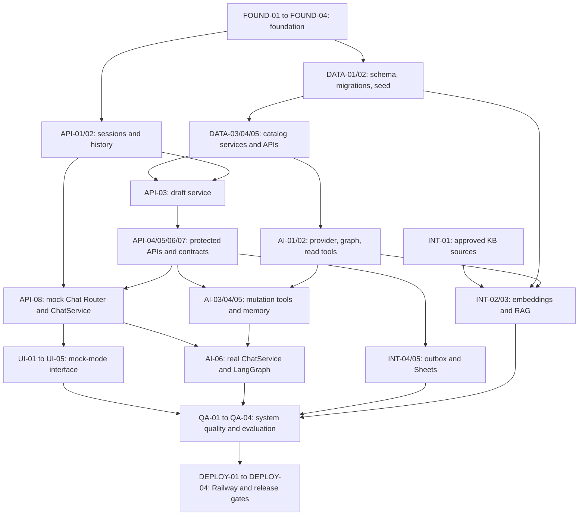

# 08 — Development Roadmap

| Field | Value |
| --- | --- |
| Organization | Queens Tech Bros (QTB) |
| Project | BioMedicHospicare Medical Supply AI Assistant |
| Version | 1.0 |
| Status | Approved |
| Owner | QTB Product and Engineering |
| Date | 2026-11-06 |
| References | [PRD v1.2](01-product-requirements.md); [Conversation Flows v1.1](02-conversation-flows.md); [Catalog & Inventory v1.0](03-product-catalog-inventory.md); [Business Operations v1.0](04-business-operations.md); [System & AI Architecture v1.0](05-system-ai-architecture.md); [Frontend Implementation Design v1.0](06-frontend-implementation-design.md); [Backend & API Design v1.0](07-backend-api-design.md) |

## 1. Purpose and roadmap principles

This roadmap turns the approved synthetic-data product and technical specifications into small, verifiable implementation increments. It is not authorization to create real orders, use real customer data, contact BioMedicHospicare staff, or change the approved scope.

- Build the smallest working version of each layer before adding capability.
- Establish deterministic FastAPI/PostgreSQL services and OpenAPI contracts before browser integration.
- Use real business services and transactions; introduce the in-process mock chat provider early so UI work is independent of LLM availability.
- Test each increment close to implementation, then integrate progressively.
- Keep local setup repeatable, external costs low, and infrastructure limited to the approved stack.
- Give Codex one bounded task or tightly related task group with explicit acceptance criteria; do not combine unrelated features.
- Prefer approved patterns over speculative abstractions or refactors.

### Scope guardrails

The roadmap preserves: a single FastAPI modular monolith; Next.js App Router frontend; PostgreSQL/pgvector; one LangGraph tool-calling agent with approximately 12 tools; OpenRouter conversational access; Gemini embeddings; one PostgreSQL outbox worker; Railway deployment; and `feature/*` → `dev` → `main` workflow. It does not add Redis, Celery, microservices, user accounts, payments, checkout, real orders, real medical care, or visible topic navigation.

## 2. Development environment and repository foundation

Before feature work, inspect the existing repository and preserve all uncommitted work. Create a simple local topology: Next.js/TypeScript frontend, FastAPI/Python backend, and local PostgreSQL with pgvector; Docker Compose may support local services where useful but is not a new production dependency.

| Concern | Planned foundation | Verification evidence |
| --- | --- | --- |
| Frontend | Next.js App Router, strict TypeScript, Tailwind CSS, shadcn/ui, Vitest/RTL, Playwright, TanStack Query, React Hook Form/Zod, Sonner. | Frontend starts, type/lint/test scripts run, and a smoke page renders. |
| Backend | FastAPI, Pydantic/Pydantic Settings, SQLAlchemy 2.0 async, psycopg 3, Alembic, pytest/pytest-asyncio/HTTPX. | App health/readiness and a database-backed test run succeed. |
| Data | Local PostgreSQL with pgvector, isolated development and test databases. | Migration and connectivity checks succeed without external AI credentials. |
| Configuration | Environment examples and local-only secret files; Pydantic Settings owns configuration. | Missing required settings fail safely; secrets are ignored by Git. |
| Quality/CI | Formatting, linting, type checks, focused tests, and smoke CI jobs. Exact commands are defined by initialized project scripts. | CI executes deterministic checks without paid model calls. |
| Developer guide | README setup/startup, test, migration, seed, and branch workflow instructions. | A new developer can follow documented local setup. |

Git ignore rules must exclude local environment files, virtual environments, dependency directories, caches, generated contract artifacts when appropriate, test/build output, coverage output, and local database volumes. Generated frontend OpenAPI types are regenerated from backend contracts, never manually treated as an independent source of truth.

## 3. Milestones and task sequence

### Phase 1 — Project Foundation

**Milestone gate:** local frontend, backend, and database start independently; health/readiness and deterministic smoke checks work with no external AI API.

| ID | Task | Description and dependencies | Primary areas | Deliverable / acceptance criteria | Verification | Size |
| --- | --- | --- | --- | --- | --- | --- |
| FOUND-01 | Inspect and scaffold workspace | Inspect repository/instructions; initialize approved frontend and backend skeletons. No feature logic. | `frontend/`, `backend/`, root docs | App roots and ownership boundaries match Documents 05–07. | Startup smoke checks. | M |
| FOUND-02 | Local database and settings | Configure local PostgreSQL/pgvector, async SQLAlchemy session, Pydantic Settings, safe env examples, and health/readiness endpoints. Depends on FOUND-01. | `backend/app/db`, `core`, local compose if useful | Database connectivity and health/readiness work; no secrets committed. | Backend health and DB connectivity tests. | M |
| FOUND-03 | Quality and CI baseline | Add formatter/linter/type/test configuration and deterministic CI smoke jobs. Depends on FOUND-01. | frontend/backend test config, CI workflow | Local commands and CI run without paid/provider calls. | Lint, types, minimal tests. | M |
| FOUND-04 | Developer setup documentation | Document local startup, migrations, seeds, tests, and `feature/* → dev → main`. Depends on FOUND-01–03. | `README.md` | Repeatable setup instructions; no production claims. | Documentation review. | S |

### Phase 2 — Database & Synthetic Product Catalog

**Milestone gate:** a fresh database migrates and seeds the approved 80 parent listings/100 unique sellable SKU variants; public reads never reveal numeric inventory.

| ID | Task | Description and dependencies | Primary areas | Deliverable / acceptance criteria | Verification | Size |
| --- | --- | --- | --- | --- | --- | --- |
| DATA-01 | Catalog relational models | Implement categories, listings, variants, inventory, compatibility, image-reference models and required constraints. Depends on FOUND-02. | `models`, Alembic | Parent/variant/SKU separation, unique SKU IDs, positive prices, nonnegative stock. | Model/constraint tests. | M |
| DATA-02 | Migrations and repeatable synthetic seeds | Create initial migration and deterministic approved catalog seed process. Depends on DATA-01. | Alembic, `dev/fixtures` | Fresh migration/seed; rerun does not silently duplicate catalog rows. | Isolated DB migration/seed tests. | M |
| DATA-03 | Catalog and inventory services | Implement deterministic exact-SKU, attribute/filter, availability, compatibility, and alternatives services. Depends on DATA-02. | `services`, scoped repositories | Quantity checks use private exact stock; public output is categorical only; alternatives ≤3. | Unit/integration fixtures. | M |
| DATA-04 | Product read APIs | Expose search, product detail, and availability contracts with cursors and public projections. Depends on DATA-03. | `api/v1/products.py`, schemas | Five-card batches, Show More cursor, resolved sellable variants, no counts. | HTTPX contract tests. | M |
| DATA-05 | Catalog regression suite | Encode Document 03 fixture cases: compatibility states, low/out/discontinued, missing image, alternatives, invalid price/stock. Depends on DATA-02–04. | backend tests | Approved catalog behavior is regression-covered. | pytest integration tests. | M |

### Phase 3 — Guest Sessions, Quotations & Core Backend APIs

**Milestone gate:** a guest can create and restore one authoritative draft, mutate it safely through direct APIs, review it, and persist a confirmed immutable synthetic quotation plus outbox record atomically.

| ID | Task | Description and dependencies | Primary areas | Deliverable / acceptance criteria | Verification | Size |
| --- | --- | --- | --- | --- | --- | --- |
| API-01 | Guest sessions and welcome | Add opaque hashed cookie sessions, rolling seven-day expiration, bootstrap, and welcome-once conversation record. Depends on FOUND-02. | sessions, models, services | No raw token is stored; returning valid sessions do not duplicate greeting. | Cookie/expiry API tests. | M |
| API-02 | Conversation persistence projections | Persist ordered messages and validated structured assistant-element snapshots; restore public history without treating historical availability as fresh. Depends on API-01. | conversations, schemas | Refresh restores cards/references/other approved elements; current facts revalidate on action. | History/serialization tests. | M |
| API-03 | Draft quotation service | Create session-scoped drafts/lines; enforce SKU resolution, explicit positive whole sales-unit quantity, one line/SKU, versions and direct-UI UUID idempotency. Depends on DATA-03, API-01. | quotations service/models/API | Add/update/remove use expected version and locks; no implicit Add-to-Quote quantity. | Unit, transaction, conflict tests. | M |
| API-04 | Review and quote submission | Create protected review records, explicit confirmation, immutable snapshots, delivery/pickup validation, and `QUOTE_SHEETS_SYNC` outbox transaction. Depends on API-03. | quotations, outbox, schemas | Commit produces submission/outbox together; quote clears only after commit; no reservation/payment/order. | HTTPX and rollback/idempotency tests. | M |
| API-05 | Support submission core | Implement opt-in/review/confirmation, immutable support inquiry, and `SUPPORT_SHEETS_SYNC` outbox transaction. Depends on API-01. | support service/API, outbox | Cancel/decline writes nothing; contact reuse requires in-session consent. | Support workflow tests. | M |
| API-06 | Error/OpenAPI/type generation | Standardize errors, expose approved Pydantic contracts, and generate frontend transport types from OpenAPI. Depends on API-01–05. | schemas, `frontend/src/lib/api` | Generated types compile; backend remains contract authority. | OpenAPI generation/type check. | S |
| API-07 | Protected-workflow integration tests | Cover operation IDs, lost responses, conflicts, review invalidation, concurrent submissions, and outbox atomicity. Depends on API-03–05. | backend tests | Uncertain mutations reconcile rather than replay; protected invariant suite passes. | Dedicated PostgreSQL test DB. | M |
| API-08 | Mock chat endpoint and provider boundary | Implement `POST /chat/messages` through FastAPI Chat Router and `ChatService` with `CHAT_PROVIDER=mock`, `ChatTurnRequest` validation, deterministic fixtures, persisted conversation/history, client-message deduplication, and authoritative quote-refresh signaling. Depends on API-01–03, API-06. | `api/v1/chat.py`, `services/chat.py`, `dev/mock_chat.py`, schemas | Mock and future LangGraph providers share the same approved Pydantic/OpenAPI `ChatTurnResponse`; mock mutations call real catalog/quotation services and PostgreSQL paths. | HTTPX mock-chat contract, history, deduplication, and mutation-reconciliation tests. | M |

### Phase 4 — Frontend Interface & Mock Chat Integration

**Milestone gate:** the approved responsive single-chat UX integrates `useChat` with the deterministic FastAPI mock endpoint, renders structured responses, and uses authoritative draft APIs through the shared services.

| ID | Task | Description and dependencies | Primary areas | Deliverable / acceptance criteria | Verification | Size |
| --- | --- | --- | --- | --- | --- | --- |
| UI-01 | Application shell and session bootstrap | Build light-mode header, demo disclosure, continuous chat, composer, and quotation count shell. Depends on FOUND-01, API-01, API-06. | `features/chat`, layout, session hooks | No sidebar/topic chips/threads/catalog/checkout; accessible loading/failure states. | RTL component tests. | M |
| UI-02 | Query and `useChat` foundation | Configure QueryClient/query keys, generated API client use, provisional user messages, reconciliation, restore, duplicate-send prevention, and authoritative quote-cache refresh from the deterministic FastAPI chat endpoint. Depends on API-02, API-06, API-08. | chat hooks, `lib/api`, query | One complete JSON response per turn; network uncertainty is not shown as failed mutation. | Hook/API mock tests against FastAPI mock mode. | M |
| UI-03 | Product result interaction | Render approved product cards, image fallbacks, availability notices, SKU clarification, and cursor-preserving Show More. Depends on DATA-04, UI-02. | products/chat components | Up to five cards/batch; card action asks quantity or uses backend clarification. | RTL/Playwright mock tests. | M |
| UI-04 | Quotation and support review UX | Add non-modal desktop drawer, mobile panel, shared draft state, line editing/removal, review/contact/fulfillment form, confirmation/error views, and opt-in support inquiry form/review/confirmation. Depends on API-03–05, UI-02. | quotation and support features | Chat remains usable on desktop; mobile preserves form/review state; changed draft invalidates review; support cancellation preserves draft/chat. | Form, drawer, support, conflict tests. | M |
| UI-05 | Comprehensive mock-mode E2E | Exercise completed chat, product, quotation, support, responsive, and recovery workflows through the existing in-process mock provider. Depends on API-08, UI-01–04. | frontend E2E tests | Same `ChatTurnResponse` contract; mock mode is not a second server and uses real shared business services for mutations. | Playwright synthetic workflows. | M |

### Phase 5 — LangGraph Agent, Tools & Conversation Memory

**Milestone gate:** the single agent safely serves product/quote conversations through the real Chat Router → ChatService → LangGraph path, authorized deterministic tools, and restored internal five-context state.

| ID | Task | Description and dependencies | Primary areas | Deliverable / acceptance criteria | Verification | Size |
| --- | --- | --- | --- | --- | --- |
| AI-01 | OpenRouter gateway/configuration | Add backend-only selected-model adapter, timeouts, token/context limits, usage/cost records, and safe provider errors. Depends on FOUND-02. | agents, core settings, usage models | One configured model; no model roulette; no credential logging. | Adapter unit tests with provider mock. | M |
| AI-02 | Graph and available read-only tools | Build agent → conditional ToolNode → agent loop and the five available read-only tool wrappers over catalog/company services. `search_knowledge_base` is added with its real retrieval service in INT-03. Depends on DATA-03–04, AI-01. | `agents/graph.py`, tools | Agent has no direct SQL/Sheets access; inputs/outputs validate. | Graph fixture tests. | M |
| AI-03 | Draft and protected tools | Add six quotation/support tool wrappers with trusted runtime session, backend operation IDs, review-state exposure, and no model-provided identity. Depends on API-03–05, AI-02. | tools, services | Tools share direct API services; protected actions require backend confirmation. | Tool auth/idempotency tests. | M |
| AI-04 | Checkpoints, internal contexts, and summaries | Configure PostgreSQL checkpointer, active+four saved contexts, LRU, request-bound pending actions, selective summaries, and natural-language resumption. Depends on API-01–02, AI-02. | graph/state/checkpointer | Checkpoint is executable-state authority; no visible topic navigation; draft remains separate. | Restart, LRU, stale-yes tests. | M |
| AI-05 | Limits and failure recovery | Enforce five tool rounds, safe read retry, mutation reconciliation, rate/budget checks, and observability. Depends on AI-01–04. | graph/core/services | Provider/round-limit failure never produces false success or blind replay. | Failure/recovery tests. | M |
| AI-06 | Real ChatService–LangGraph integration | Complete the `FastAPI Chat Router → ChatService → LangGraph` provider path using the API-08 contract: validate request/response, persist customer/validated assistant messages and checkpoints, deduplicate `client_message_id`, reconcile uncertain tool mutations by stable operation ID, and signal authoritative quote-cache refresh when committed state changes. Depends on API-02, API-06, API-08, AI-02–05. | `api/v1/chat.py`, `services/chat.py`, agents, schemas | The real provider returns the same Pydantic/OpenAPI `ChatTurnResponse` as mock mode; no false success after uncertain mutation or provider/round-limit failure. | HTTPX/graph integration, restart, deduplication, reconciliation, and quote-refresh tests. | M |

### Phase 6 — RAG, Support Inquiries & Google Sheets Worker

**Milestone gate:** approved information is grounded or abstained, and both persisted submission types synchronize asynchronously without blocking customer confirmation.

| ID | Task | Description and dependencies | Primary areas | Deliverable / acceptance criteria | Verification | Size |
| --- | --- | --- | --- | --- | --- | --- |
| INT-01 | Approved knowledge source authoring | Create the six actual KB sources only from Document 04 specifications, with provenance/approval metadata and demo disclosures. Depends on human-approved content review. | approved KB source area | No invented real policies/contact facts; six scope documents ready for ingestion. | Content/metadata review. | M |
| INT-02 | KB ingestion and embeddings | Implement manual/offline approve→chunk→Gemini embed→pgvector ingestion/versioning flow. Depends on INT-01, DATA-01. | KB services/scripts/models | Compatible model/dimension persisted; unapproved text is not retrievable. | Mocked ingestion DB tests. | M |
| INT-03 | RAG retrieval and citations | Add the sixth read-only tool, `search_knowledge_base`, with approved-chunk retrieval, `RAG_TOP_K=1`, threshold, citation and abstention. Depends on INT-02, AI-02. | knowledge service/tool | Structured company facts use `get_company_info`; unsupported questions abstain. | Grounding/abstention fixtures. | M |
| INT-04 | Outbox worker | Implement one lightweight worker with leases, `SKIP LOCKED` claims, attempts/backoff, restart recovery, and observability. Depends on API-04–05. | workers/outbox | `QUOTE_SHEETS_SYNC` and `SUPPORT_SHEETS_SYNC` share worker; no broker/Celery/Redis. | Lease/retry/crash tests. | M |
| INT-05 | Sheets adapters and reconciliation | Add minimal tab payloads, stable references, duplicate lookup/reconciliation, and safe terminal failure visibility. Depends on INT-04. | workers/sheets | At-least-once external delivery with reconciliation, never claimed exactly-once; failure never rolls back DB record. | Mock Sheets integration tests. | M |

### Phase 7 — End-to-End Quality & AI Evaluation

**Milestone gate:** critical deterministic workflows and protected-action invariants pass; AI results are recorded rather than assumed.

| ID | Task | Description and dependencies | Primary areas | Deliverable / acceptance criteria | Verification | Size |
| --- | --- | --- | --- | --- | --- | --- |
| QA-01 | Deterministic regression matrix | Consolidate pytest, transaction, API, and catalog cases for sessions, variants, inventory, drafts, submissions, worker and RAG. Depends on Phases 2–6. | backend tests | Critical deterministic suite passes with isolated DB/mocks. | pytest/HTTPX. | M |
| QA-02 | Frontend quality suite | Add Vitest/RTL and Playwright coverage for chat/drawer/forms/mobile/session restoration and safe retries. Depends on Phase 4. | frontend tests | No visible topic navigation; drawer/chat and form-state requirements covered. | Component/E2E mock-mode tests. | M |
| QA-03 | AI evaluation suite | Define/run approximately 65 reproducible scenarios across configured candidates under controlled budgets. Depends on Phase 5–6. | evaluation fixtures/results | Track tool selection, grounding, confirmation safety, recovery, latency, token/cost; no invented threshold. | Recorded evaluation run. | M |
| QA-04 | Safety, privacy, and release review | Test medical boundaries, injection resistance, authorization, public inventory redaction, rate/budget exhaustion, accessibility, and responsive behavior. Depends on QA-01–03. | cross-cutting tests/review | Protected-action safety is a release gate; no real operations/secrets exposed. | Security/accessibility/manual review. | M |

### Phase 8 — Railway Deployment & Portfolio Release

**Milestone gate:** an explicitly approved public synthetic demonstration runs safely on Railway with production controls and release prerequisites met.

| ID | Task | Description and dependencies | Primary areas | Deliverable / acceptance criteria | Verification | Size |
| --- | --- | --- | --- | --- | --- | --- |
| DEPLOY-01 | Railway service configuration | Configure frontend, FastAPI, PostgreSQL/pgvector, and single worker services; define separate local/Railway databases. Depends on QA gates. | deployment configuration/docs | Health checks, service connectivity, migration/seed/ingestion procedure documented. | Authorized nonproduction deployment check. | M |
| DEPLOY-02 | Production security/configuration gate | Set environment secrets, HTTPS cookie/CSRF behavior, mock-mode startup prohibition, budgets/rates, credentials, logs, and private Sheets access. Depends on DEPLOY-01. | Railway settings/release checklist | No secret in source; production cannot start mock mode. | Config/security checklist. | M |
| DEPLOY-03 | Public demo release gate | Verify permissions/branding, synthetic disclosures, contact-data retention/cleanup policy approval, smoke flows, safe Sheets failure, and no real orders/medical advice. Depends on DEPLOY-02, QA-04. | release checklist | Public launch occurs only with all critical gates and explicit owner approval. | HTTPS smoke/E2E checklist. | M |
| DEPLOY-04 | Portfolio handoff | Publish accurate QTB case-study/user documentation describing synthetic scope, architecture, evidence, and limitations. Depends on DEPLOY-03. | portfolio docs | No production or live-business claim; evidence matches implementation. | Documentation review. | S |

## 4. Dependency map and critical path

**Critical path:** foundation → schema/seed plus sessions → mock Chat Router/ChatService → frontend mock integration → draft/submission contracts → agent/memory plus real ChatService–LangGraph integration and outbox/RAG → quality gates → approved deployment. Knowledge-source authoring (INT-01) can proceed in parallel with Phases 2–5 after business-content review. UI shell work can start after API-01/API-06, while `useChat` starts after API-08; neither waits for paid AI. Outbox work can begin after API-04/API-05 and run in parallel with RAG.

**Integration checkpoints:** (1) migration/seed repeatability before catalog API work; (2) generated OpenAPI types and the mock Chat Router contract before `useChat`; (3) session/draft/version/outbox transaction tests before protected UI review; (4) mock-mode E2E before live agent; (5) real ChatService deduplication/reconciliation and checkpointer LRU/recovery before AI evaluation; (6) worker reconciliation before public-release review.

## 5. Testing throughout development

| Milestone | Tests introduced immediately | External dependency policy |
| --- | --- | --- |
| Foundation | Health, settings, startup, type/lint smoke tests. | No external AI or Sheets. |
| Catalog | Model constraints, seeds, compatibility, categorical availability, search/alternatives APIs. | Local PostgreSQL only. |
| Sessions/quotes | Cookies/expiry, history restore, versions, idempotency, locks, review/submit/outbox transactions. | Dedicated PostgreSQL test database. |
| Frontend/mock | Component/hook/form tests and Playwright mock workflows. | Mock chat; real backend business services where mutations matter. |
| Agent/RAG/worker | Graph fixtures, tool authorization, LRU, RAG citation/abstention, worker lease/retry/reconciliation. | Provider/Sheets clients mocked in ordinary CI. |
| Quality/release | End-to-end workflows, accessibility/responsive checks, approximately 65 controlled AI evaluations, security/privacy review. | Live model/embedding evaluation only in deliberate budgeted runs. |

No ordinary CI job requires paid LLM, embedding, or Google Sheets calls. A live integration run is recorded with provider, model, fixtures, limits, date, and outcome; it is not extrapolated from mock results.

## 6. Definition of Done and acceptance gates

### Task-level Definition of Done

- The task maps to relevant approved documents and stays within scope.
- Implementation follows the approved architecture and deterministic-service boundaries.
- Relevant unit/API/component/transaction/E2E tests are added or updated and actual checks are reported.
- Loading, error, empty, authorization, and data-scope states are addressed where applicable.
- Prices, inventory, sessions, protected operations, and secrets remain authoritative/private as specified.
- No unrelated changes, unsafe retry path, or duplicate schema source is introduced.
- Documentation and generated contract artifacts are updated where relevant; verification evidence is recorded.
- The change is ready for human review; it is not automatically committed or deployed.

### Milestone gates

| Gate | Blockers | Non-blocking follow-up examples |
| --- | --- | --- |
| Data/API gate | Failed migrations/seeds, exposed counts, broken SKU/quote constraints, unprotected submission transaction. | Query/index optimization after measured use. |
| Mock UI gate | Contract mismatch, inability to restore draft/history, inaccessible quote controls, visible forbidden topic navigation. | Minor visual polish not affecting usability. |
| AI/integration gate | Tool authorization bypass, stale/unsafe confirmation, LRU/checkpoint failure, ungrounded policy claim, unreconciled submission/worker behavior. | Additional noncritical evaluation fixtures. |
| Public-release gate | Any P0/P1 security/safety/privacy issue, unresolved contact-retention policy, missing branding permission, failed critical workflow, real-operation implication. | Explicitly documented noncritical polish. |

## 7. Codex implementation workflow

Every implementation request should state:

1. One roadmap task ID (or tightly coupled IDs) and approved-document references.
2. Exact deliverables and explicit out-of-scope items.
3. Acceptance criteria, relevant edge cases, and expected test commands.
4. Existing code to inspect before editing and any known pre-existing work.
5. Required concise final report: changed files, behavior, tests actually run, and remaining risks.

Codex must inspect current implementation before editing, preserve uncommitted work, report a conflict with approved specifications instead of silently diverging, and avoid rebuilding completed modules. It must not commit, deploy, alter remote services, or treat a proposed implementation detail as a product approval without explicit owner direction.

## 8. Risk register

| Risk | Mitigation | Gate / evidence |
| --- | --- | --- |
| Unexpected OpenRouter cost | Single selected model, response/context limits, usage tracking, per-session/global caps, controlled evaluation runs. | AI-01/05; QA-03. |
| Gemini embedding failure | Mock normal CI; ingestion/retrieval errors abstain safely; record model/dimension version. | INT-02/03 tests. |
| Tool hallucination/unsafe execution | Narrow tools, trusted runtime context, deterministic service validation, five-round cap. | AI-02–05; QA-04. |
| Checkpoint/request divergence | Checkpointer is executable-state authority; projection rebuilds only from checkpoint; LRU/restart tests. | AI-04. |
| Cookie/CSRF deployment issue | Same-origin preference, explicit HTTPS/CORS/cookie review before launch. | API-01; DEPLOY-02. |
| Quote duplication | Expected versions, locks, operation IDs, review binding, atomic submission/outbox. | API-03/04/07. |
| Duplicate Sheets rows | Stable references, at-least-once reconciliation, lease/attempt tracking; no exactly-once claim. | INT-04/05. |
| Migration mistake | Rehearse fresh migration/seed and rollback behavior on isolated databases. | DATA-02; QA-01. |
| Model-quality variance | Equivalent evaluation scenarios across candidates; protected safety gate independent of aggregate score. | QA-03. |
| Public-demo abuse | Input limits, rate/budget caps, opaque sessions, validated tools, safe errors. | AI-05; QA-04; DEPLOY-02. |
| Unverified branding usage | Confirm permission and approved asset use before public release. | DEPLOY-03. |
| Real visitor contact data | Minimize fields, disclosures, private Sheets access, no real forwarding, approved retention/cleanup policy before launch. | API-04/05; DEPLOY-03. |
| Oversized Codex tasks | Use roadmap IDs, small/medium scope, task DoD, and milestone gates. | Section 7. |

## 9. Deferred implementation-time decisions

The following are proposals or implementation-time choices, not newly approved product requirements:

- Final OpenRouter model identifier and evaluation selection.
- Numeric request, token, budget, timeout, retry, and relevance thresholds other than the approved five tool rounds.
- Exact cookie/CSRF/header names and deployment-specific CORS values.
- Approved contact-data retention and cleanup duration.
- Sheets columns/tab ordering and operational credential setup.
- Measured database index/performance tuning and migration deployment mechanics.
- Exact Railway environment values and service naming.

Resolve each before its associated implementation or public-release gate. No unresolved detail authorizes a change to synthetic-only scope, privacy boundaries, safety limits, or protected submission behavior.

## 10. Traceability and final review checklist

| Approved area | Roadmap coverage |
| --- | --- |
| BR-001–BR-003; FR-001, FR-008–FR-011 | DATA-01–05, UI-03, AI-02, QA-01/02. |
| FR-002, FR-004 | API-01/02, AI-04, UI-01/02, QA-01/02. |
| FR-003, FR-005, FR-006 | API-03/04/07, UI-04, INT-04/05, QA-01/02. |
| FR-007, FR-013 | INT-01–03, AI-02, QA-03/04. |
| FR-012, FR-016 | API-05, INT-04/05, UI-04, QA-01/02. |
| FR-014, FR-015, NFR-001 | FOUND-03, AI-05, QA-01–04, DEPLOY-02/03. |
| Document 06 UI constraints | UI-01–05, QA-02. |
| Document 07 contracts/chat/outbox/recovery | API-01–08, AI-03–06, INT-04/05, QA-01. |

Before approval of this roadmap, confirm task owners, exact local scripts, initial model/provider test budget, and whether approved KB sources can be authored. Before public release, independently confirm all NFR-001 critical workflows, business-branding permission, production configuration, and the contact-data retention/cleanup policy. This document creates no implementation artifacts and does not authorize deployment.
